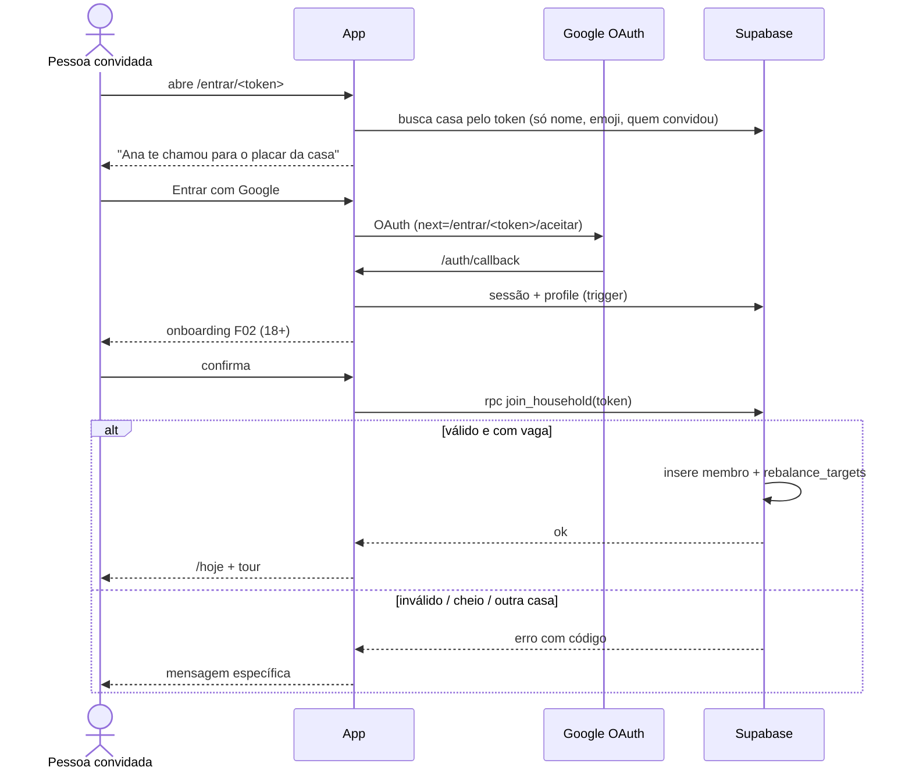
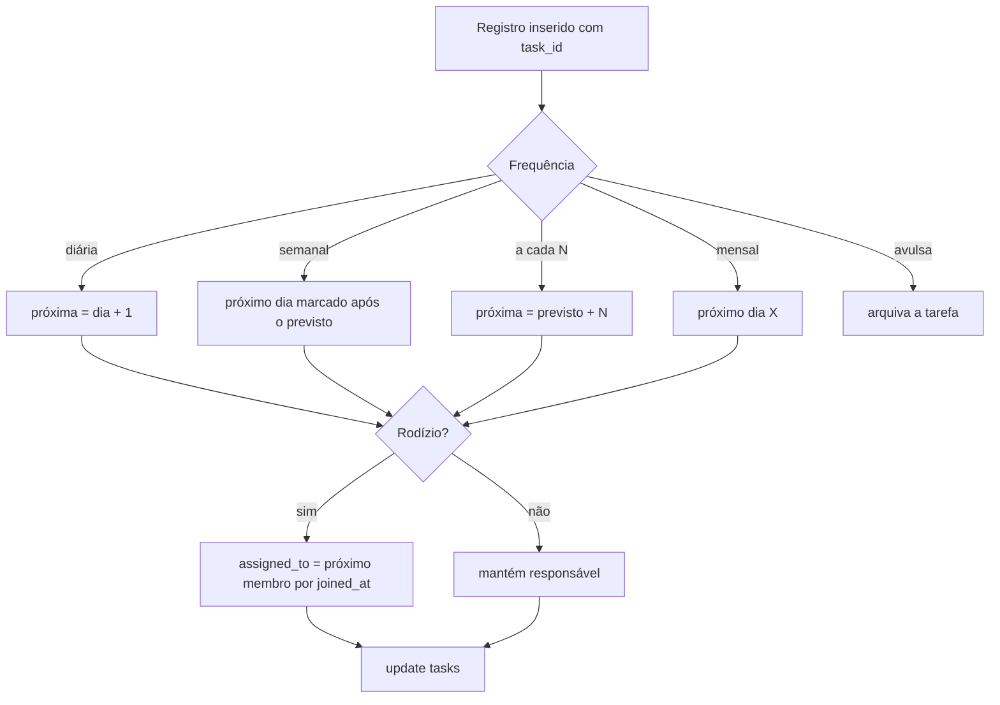
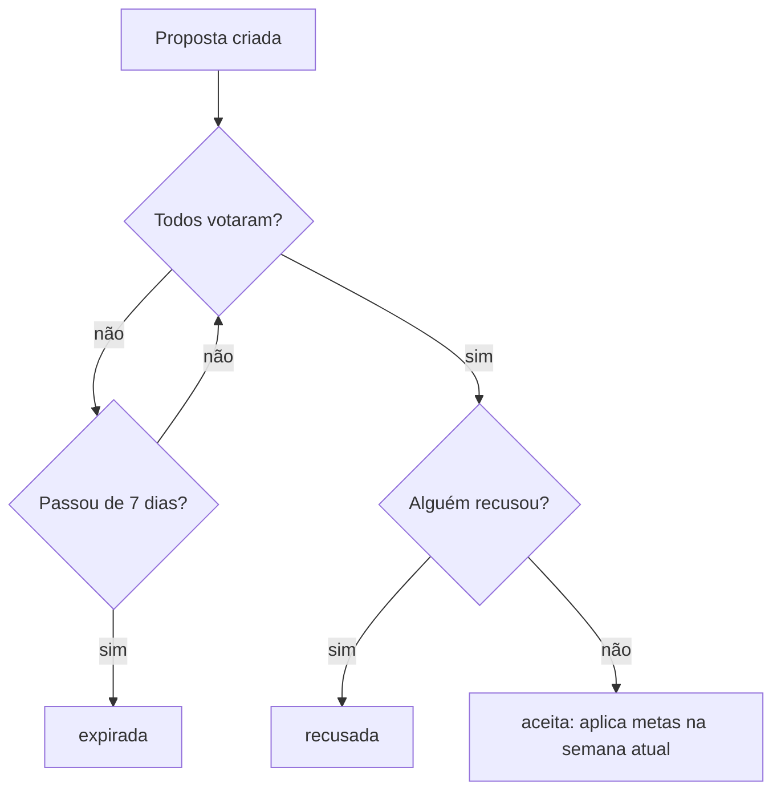
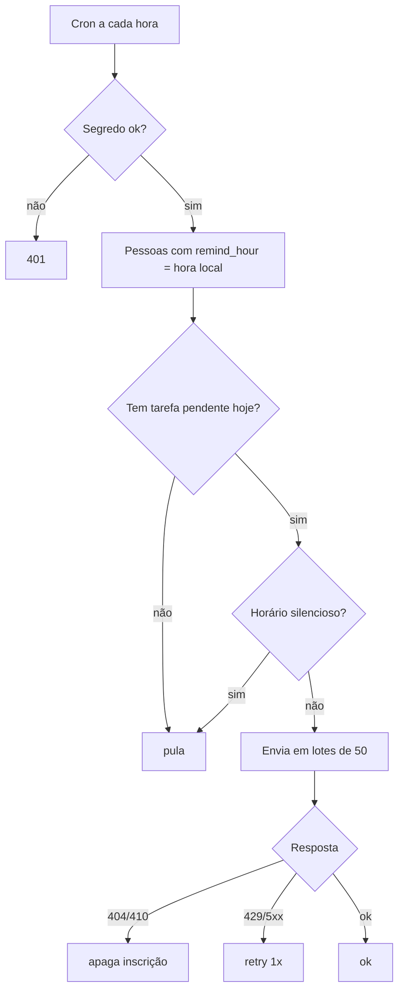

# Placar — Mapa de fluxos do sistema

Este documento é a referência dos fluxos do Placar para implementação e testes. Ele complementa o `docs/roadmap.md`: os nomes de tabelas, rotas e fases seguem o roadmap, e cada fluxo indica a fase em que nasce.

**Convenções:**
- `SA:nome` é uma *server action* do Next.js; `RPC:nome` é uma função SQL chamada via `supabase.rpc`; `GET/POST /rota` é um Route Handler.
- `→` separa a ação do usuário da resposta do sistema.
- As mensagens entre aspas são o texto exato da tela.
- Os comportamentos que valem para todas as telas (sem internet, sessão expirada, erro 500, rate limit, navegador interno do Instagram/TikTok) estão na seção **X**.
- **Regra de tom, que vale para todo texto:** "time, não culpa". Nenhuma mensagem compara pessoas de forma humilhante; falar de alguém abaixo da meta é sempre "falta X para chegar", nunca "fulano está devendo".

---

## 1. Atores

| ID | Ator | Descrição |
|---|---|---|
| A1 | Visitante | Pessoa não logada: vê a landing e as páginas de convite |
| A2 | Membro | Pessoa logada que participa de uma casa |
| A3 | Admin da casa | Membro com `role = 'admin'` (quem criou ou recebeu a transferência) |
| A4 | Pagante | Membro que assina o Premium da casa |
| A5 | Operador | Você: liga e desliga features e faz o suporte |
| S1 | App (Next.js na Cloudflare) | Páginas, server actions e route handlers |
| S2 | Supabase | Postgres, RLS, Auth, Realtime e funções SQL |
| S3 | Service Worker | Cache, fila offline e push |
| E1 | Google OAuth | Autenticação |
| E2 | Web Push (APNs/FCM) | Entrega de notificações |
| E3 | Stripe | Checkout, assinaturas e webhooks |
| E4 | WhatsApp / Instagram (folha de compartilhar) | Destino de convites e cards |
| E5 | Sentry / PostHog | Erros e eventos |
| J1 | Cron horário (Cloudflare) | Fechamento da semana, lembretes e avisos |
| J2 | Cron diário (Cloudflare) | Wrapped, manutenção e expirações |

---

## 2. Lista completa de fluxos

| ID | Fluxo | Ator | Fase |
|---|---|---|---|
| **A. Conta** ||||
| F01 | Primeiro acesso (cadastro via Google) | A1 | 1 |
| F02 | Onboarding pessoal (nome, 18+, aparecer nos cards) | A2 | 2 |
| F03 | Login recorrente | A1 | 1 |
| F04 | Logout | A2 | 1 |
| F05 | Editar perfil e preferências | A2 | 2 |
| F06 | Exportar meus dados (LGPD) | A2 | 14 |
| F07 | Excluir conta | A2 | 14 |
| **B. Casa** ||||
| F08 | Criar casa a partir de um modelo | A2 | 4 |
| F09 | Convidar membro | A2 | 4 |
| F10 | Entrar na casa pelo convite | A1 | 4 |
| F11 | Editar a casa | A3 | 4 |
| F12 | Gerenciar membros (remover, transferir admin) | A3 | 4 |
| F13 | Sair da casa | A2 | 4 |
| F14 | Excluir a casa | A3 | 4 |
| **C. Tarefas** ||||
| F15 | Criar tarefa | A2 | 5 |
| F16 | Adicionar tarefas do modelo | A2 | 5 |
| F17 | Editar, arquivar e reativar tarefa | A2 | 5 |
| F18 | Listar, filtrar e buscar tarefas | A2 | 5 |
| F19 | Calcular a próxima data e o rodízio | S2 | 5 |
| **D. Dia a dia** ||||
| F20 | Ver a tela Hoje | A2 | 6 |
| F21 | Marcar tarefa como feita | A2 | 6 |
| F22 | Desfazer registro | A2 | 6 |
| F23 | Registrar tarefa extra | A2 | 6 |
| F24 | Reagir a um registro | A2 | 6 |
| F25 | Ver a atividade da casa | A2 | 6 |
| F26 | Cutucar um membro | A2 | 6 |
| **E. Placar** ||||
| F27 | Ver o placar da semana ao vivo | A2 | 7 |
| F28 | Propor nova divisão | A2 | 7 |
| F29 | Votar na proposta de divisão | A2 | 7 |
| F30 | Fechar a semana | J1 | 7 |
| F31 | Ver o histórico de semanas | A2 | 7 |
| **F. Sequência e conquistas** ||||
| F32 | Calcular a "casa em dia" | S2 | 8 |
| F33 | Usar congelamento | A2 | 8 |
| F34 | Ganhar conquista | S2 | 8 |
| F35 | Ver conquistas | A2 | 8 |
| **G. Cards, Wrapped e aposta** ||||
| F36 | Gerar e compartilhar card | A2 | 10 |
| F37 | Ver e compartilhar o Wrapped do mês | A2 | 13 |
| F38 | Criar aposta da semana | A2 | 13 |
| F39 | Resolver a aposta | J1 | 13 |
| **H. Compras** ||||
| F40 | Usar a lista de compras compartilhada | A2 | 12 |
| **I. PWA e notificações** ||||
| F41 | Instalar o app | A2 | 9 |
| F42 | Ativar e configurar notificações | A2 | 11 |
| F43 | Receber e tocar numa notificação | E2 | 11 |
| F44 | Usar o app offline | A2 | 9 |
| F45 | Atualizar para uma nova versão | S3 | 9 |
| **J. Premium** ||||
| F46 | Assinar o Premium da casa | A2 | 16 |
| F47 | Renovação da assinatura | E3 | 16 |
| F48 | Falha de pagamento | E3 | 16 |
| F49 | Gerenciar ou cancelar a assinatura | A4 | 16 |
| F50 | Tentar usar recurso Premium (paywall) | A2 | 16 |
| F51 | Pagante sai da casa / volta para o grátis | A4 | 16 |
| **K. Permissões** ||||
| F52 | Permissão negada | A1 | 14 |
| **L. Operação** ||||
| F53 | Feature flags, manutenção e suporte | A5 | 14 |
| **M. Jobs** ||||
| F54 | Job de lembretes e cutucadas | J1 | 11 |
| F55 | Job de avisos (resultado da semana, proposta, Wrapped) | J1 | 11 |
| F56 | Job de manutenção | J2 | 11 |

### 2.1 Checagem de cobertura obrigatória

| Item | Situação |
|---|---|
| Cadastro | F01, F02 |
| Verificação de e-mail | **Descartado:** o login é só com Google, que já entrega o e-mail verificado |
| Login e logout | F03, F04 |
| Recuperação e troca de senha | **Descartado:** não há senha; perda da conta Google é tratada por suporte (F53) |
| Onboarding | F02 (pessoal), F08 (casa), F10 (entrada por convite) |
| CRUD das entidades principais | `profiles` F01/F05/F07 · `households` F08/F11/F14 · `household_members` F10/F12/F13 · `tasks` F15–F17 · `task_completions` F21–F23 · `reactions` F24 · `split_proposals`/`split_votes` F28/F29 · `streak_freezes` F33 · `bets` F38/F39 · `shopping_items` F40 · `nudges` F26 · `push_subscriptions` F42/F56 · `subscriptions` F46–F51 · `weekly_results` F30 · `member_achievements` F34 · `app_config` F53 |
| Busca e filtragem | F18 (tarefas), F25 (atividade paginada), F31 (histórico), F40 (sugestões) |
| Permissão negada | F52 |
| Sessão expirada | X.2 |
| Pagamento e falha de pagamento | F46–F51 |
| Fluxos administrativos | F11, F12, F14 (admin da casa), F53 (operador) |
| Jobs em background | F30, F39, F54, F55, F56 |
| Moderação de conteúdo público | **Descartada:** não há conteúdo público; tudo é privado da casa, e os cards saem do app como imagem. Abuso dentro da casa é tratado com "sair da casa" (F13) sem depender de ninguém |

---

## 3. Detalhamento dos fluxos

### A. Conta

#### F01 — Primeiro acesso (cadastro via Google)
- **Ator:** Visitante. **Gatilho:** "Entrar com Google" na landing, em /entrar ou num convite.
- **Pré-condições:** sem sessão; e-mail nunca usado.

**Passos:**
1. Toca "Entrar com Google" → `signInWithOAuth({provider:'google', redirectTo:'/auth/callback?next=…'})`. *Dados:* provider e `next` (ex.: `/entrar/<token>`).
2. Escolhe a conta → o Google redireciona para `GET /auth/callback?code=…`.
3. → `exchangeCodeForSession` grava os cookies httpOnly.
4. → o trigger `on_auth_user_created` cria `profiles` com nome e avatar do Google, `is_adult_confirmed = false`.
5. → S1 vê que a autodeclaração não foi feita e redireciona para /bem-vindo (F02), preservando o `next`.

**Alternativos:**
- **1a. Veio de convite:** depois do F02, segue para o F10.

**Erros:**
- **2e. Cancelou no Google:** "Login cancelado. Tente de novo quando quiser."
- **3e. Code inválido:** "Não foi possível entrar. Tente novamente."
- **4e. Falha no trigger:** "Tivemos um problema ao criar sua conta. Tente de novo em instantes." O callback cria o profile se ele estiver faltando.

**Pós-condições:** `auth.users` + `profiles`, com sessão ativa.

**Efeitos:** evento `signup`.

#### F02 — Onboarding pessoal
- **Ator:** Membro (ainda sem casa). **Gatilho:** redirecionamento com `is_adult_confirmed = false`.

**Passos:**
1. /bem-vindo → mostra o nome de exibição (editável), o checkbox "Confirmo que tenho 18 anos ou mais" (com link para os termos) e o toggle "Pode mostrar meu nome nos cards que a minha casa compartilhar" (ligado por padrão, com explicação curta).
2. Toca "Continuar" → `SA:completeProfile({display_name, show_in_cards})` + `RPC:confirm_adult()`, que grava `is_adult_confirmed = true` e `adult_confirmed_at`.
3. → redireciona para o `next` pendente (convite) ou para /casa/nova.

**Alternativos:**
- **3a. Já é membro de uma casa** (por exemplo, entrou antes de uma migração): vai direto para /hoje.

**Erros:**
- **2e. Caixa de 18+ desmarcada:** o botão fica desabilitado, com a dica "O Placar é para maiores de 18 anos."
- **2e. Nome vazio ou com mais de 40 caracteres:** "Use um nome de 1 a 40 caracteres."

**Pós-condições:** perfil completo.

**Efeitos:** evento `onboarding_completed`.

#### F03 — Login recorrente
- **Ator:** Visitante. **Gatilho:** "Entrar com Google".

**Passos:**
1. Passos 1–3 do F01.
2. → com o perfil completo, redireciona para o `next` ou para /hoje. Sem casa, vai para /casa/nova.

**Erros:** os mesmos do F01.

**Efeitos:** evento `login`.

#### F04 — Logout
- **Ator:** Membro. **Gatilho:** Perfil → "Sair".

**Passos:**
1. A confirmação "Sair da sua conta neste aparelho?" → `GET /sair` → signOut.
2. → S3 limpa os caches com dados pessoais → redireciona para /.

**Erros:**
- **Rede caiu:** os cookies são limpos mesmo assim.

**Pós-condições:** sem sessão; a inscrição de push do aparelho é mantida.

#### F05 — Editar perfil e preferências
- **Ator:** Membro. **Gatilho:** /config.

**Passos:**
1. Altera o nome, o avatar (upload para `avatars/<uid>/…webp`, até 1 MB depois de comprimir), o fuso pessoal ou o toggle "Aparecer nos cards".
2. → `SA:updateProfile(patch)`. O grant por coluna impede mexer em `is_adult_confirmed`.
3. → toast "Perfil atualizado".

**Alternativos:**
- **1a. Desligou "Aparecer nos cards":** aviso "Seus colegas de casa não vão poder mostrar seu nome nem sua foto nos cards. Cards já postados não mudam."

**Erros:**
- **1e. Imagem acima de 5 MB:** "A imagem precisa ter até 5 MB."
- **1e. Formato inválido:** "Envie uma imagem JPG, PNG ou WEBP."

**Pós-condições:** `profiles` atualizado.

#### F06 — Exportar meus dados
- **Ator:** Membro. **Gatilho:** /config → "Baixar meus dados".

**Passos:**
1. → `GET /api/me/export` reúne `profiles`, a participação na casa, os registros feitos pela pessoa, reações, cutucadas enviadas, propostas, votos, conquistas e dados de assinatura.
2. → baixa `placar-dados-AAAA-MM-DD.json`.

**Erros:**
- **Rate limit** (3 por dia): "Você já baixou seus dados hoje. Tente amanhã."

**Efeitos:** log de auditoria `data_export`.

#### F07 — Excluir conta
- **Ator:** Membro. **Gatilho:** /config → "Excluir minha conta".

**Passos:**
1. Modal: "Isso apaga sua conta. Na sua casa, seus registros continuam no placar como 'Ex-morador(a)', sem seu nome." A pessoa digita "EXCLUIR" para confirmar.
2. → `SA:deleteAccount()`:
   - se for pagante, aplica o F51 (cancela a renovação e avisa a casa);
   - se for o único admin com outros membros, transfere o admin para o membro mais antigo;
   - torna anônimos os `task_completions.done_by` da pessoa (troca por um usuário "Ex-morador(a)" da casa) e apaga as reações, as cutucadas e os votos;
   - se for o último membro, apaga a casa;
   - apaga os arquivos do Storage e chama `auth.admin.deleteUser`.
3. → signOut e o toast "Sua conta foi excluída."

**Erros:**
- **1e. Texto errado:** "Digite EXCLUIR para confirmar."
- **2e. Falha no Stripe:** "Não conseguimos cancelar a assinatura agora. Tente de novo ou fale com a gente." Nada é apagado.

**Pós-condições:** não sobra nenhum dado pessoal; o placar da casa continua consistente.

**Efeitos:** push para os membros: "Um(a) morador(a) saiu da casa." (sem detalhes); evento `account_deleted`.

> **Nota de implementação:** para tornar o histórico anônimo sem quebrar as FKs, crie por casa, sob demanda, um membro técnico "Ex-morador(a)" (um usuário sem login, `role = 'member'`, que não conta como vaga). A alternativa é `done_by` nullable com `done_by_label = 'Ex-morador(a)'`. Decida na Fase 14 e registre em Desvios.

### B. Casa

#### F08 — Criar casa a partir de um modelo
- **Ator:** Membro sem casa. **Gatilho:** /casa/nova.

**Passos:**
1. Preenche o nome (ex.: "Apê da Ana e do João"), o emoji e o tipo: Casal, República ou Amigos dividindo apê.
2. → `RPC:create_household({name, emoji, kind})` cria a casa (fuso = o fuso pessoal, virada às 4h, semana começando na segunda), insere a pessoa como admin com meta 100 e copia as tarefas do modelo do tipo, com `next_due_on` calculado.
3. → a tela "Sua casa está pronta 🏠" mostra as tarefas criadas com "Revisar tarefas" e o passo seguinte, "Chamar quem mora com você" (F09).

**Alternativos:**
- **1a. "Começar do zero":** cria a casa sem tarefas.

**Erros:**
- **1e. Nome vazio ou com mais de 40 caracteres:** "Dê um nome de 1 a 40 caracteres para a casa."
- **2e. Já participa de outra casa:** "Você já está na casa <nome>. Saia dela antes de criar outra."

**Pós-condições:** existem `households`, 1 `household_members` e N `tasks`.

**Efeitos:** evento `household_created {kind, tasks}`.

#### F09 — Convidar membro
- **Ator:** Membro. **Gatilho:** depois do F08, ou em /casa/config → "Convidar".

**Passos:**
1. → S1 mostra o link `https://<domínio>/entrar/<invite_token>` (válido por 7 dias) e o texto "Bora organizar a casa juntos? Criei nosso placar no Placar 🏠 Entra aqui: <link>".
2. Toca "Mandar convite" → `navigator.share({text, url})` → abre o WhatsApp ou outro app.
3. → evento `invite_sent`.

**Alternativos:**
- **2a. Sem Web Share:** "Link copiado!"
- **1a. Link vencido:** o link é renovado automaticamente ao abrir a tela, e o admin pode gerar outro manualmente (o anterior deixa de valer).

**Erros:**
- **1e. Casa cheia no plano** (2 no grátis): "A casa já tem 2 pessoas. No Premium, cabem até 8." e um link para o F50.

**Pós-condições:** nada muda (ou o token é renovado).

#### F10 — Entrar na casa pelo convite
- **Ator:** Visitante ou membro sem casa. **Gatilho:** abre /entrar/[token].

**Passos:**
1. → página pública com o emoji, o nome da casa, "Ana te chamou para o placar da casa", três frases de como funciona e "Entrar com Google".
2. → F01/F03 com `next=/entrar/<token>/aceitar` → F02, se for o primeiro acesso.
3. → `RPC:join_household(token)` valida o token, a validade, as vagas do plano, a autodeclaração 18+ e que a pessoa não está em outra casa. Insere o membro (`role = 'member'`, cor livre) e o `rebalance_targets` deixa as metas iguais.
4. → /hoje com o toast "Você entrou na casa 🏠" e um tour de 3 passos (marcar feito, placar, reações).

**Alternativos:**
- **1a. Já está logado e sem casa:** vai direto ao passo 3, com o botão "Entrar na casa".

**Erros:**
- **3e. Token inválido ou trocado:** "Esse convite não vale mais. Peça um link novo para quem te chamou."
- **3e. Expirado:** "Esse convite expirou. Peça um link novo para quem te chamou."
- **3e. Casa cheia:** "Essa casa já está cheia no plano atual."
- **3e. Já está em outra casa:** "Você já está na casa <nome>. Para entrar nesta, saia da outra primeiro." com um link para o F13.
- **3e. Já é membro desta casa:** vai para /hoje sem erro.

**Pós-condições:** novo membro, metas somando 100.

**Efeitos:**
- Push para os outros membros: "João entrou na casa! 🎉" (F55).
- Entrada na atividade.
- Evento `invite_accepted`.



#### F11 — Editar a casa
- **Ator:** Admin. **Gatilho:** /casa/config.

**Passos:**
1. Altera o nome, o emoji, o fuso, a virada do dia (0 a 6h) ou o início da semana → `SA:updateHousehold(patch)` (RLS: só admin).
2. → toast "Casa atualizada".

**Alternativos:**
- **1a. Mudou o fuso, a virada ou o início da semana:** aviso "Isso vale daqui pra frente. Dias e semanas já registrados não mudam."

**Erros:**
- **1e. Membro comum tentando editar:** os campos aparecem só para leitura, com "Só quem administra a casa pode mudar isso."

**Pós-condições:** `households` atualizado.

**Efeitos:** entrada na atividade ("Ana mudou o nome da casa").

#### F12 — Gerenciar membros
- **Ator:** Admin. **Gatilho:** /casa/config → toque num membro.

**Passos:**
1. **Remover:** a confirmação "Remover João da casa? Os registros dele continuam no histórico." → `SA:removeMember(user_id)` → delete + `rebalance_targets`.
2. **Transferir admin:** "Passar a administração para João?" → `RPC:transfer_admin(user_id)` → João vira admin e quem transferiu vira membro.

**Alternativos:**
- **1a. O removido era o pagante:** aplica o F51.

**Erros:**
- **1e. Tentar remover a si mesmo por aqui:** a opção não aparece; o caminho é o F13.

**Pós-condições:** membros e metas atualizados.

**Efeitos:**
- Push ao removido: "Você não faz mais parte da casa <nome>."
- A entrada na atividade é neutra: "João saiu da casa".

#### F13 — Sair da casa
- **Ator:** Membro. **Gatilho:** /casa/config → "Sair da casa".

**Passos:**
1. Confirmação: "Sair da casa <nome>? Você perde o acesso ao placar e às tarefas. Seus registros continuam no histórico da casa."
2. → `SA:leaveHousehold()`:
   - se a pessoa for o único admin com outros membros, o admin passa para o membro mais antigo;
   - se for a última pessoa, a casa é apagada;
   - nos demais casos, a linha da pessoa é removida e as metas são rebalanceadas.
3. → /casa/nova com o toast "Você saiu da casa."

**Alternativos:**
- **2a. É o pagante:** F51.

**Erros:** nenhum bloqueante. **Sair nunca depende de aprovação de ninguém.**

**Pós-condições:** a pessoa fica sem casa.

**Efeitos:** push neutro aos outros membros: "Um(a) morador(a) saiu da casa."

#### F14 — Excluir a casa
- **Ator:** Admin. **Gatilho:** /casa/config → "Excluir casa".

**Passos:**
1. Modal: "Isso apaga a casa, as tarefas e todo o histórico para todos os membros." A pessoa digita o nome da casa.
2. → `SA:deleteHousehold()`: cancela a renovação do Premium no Stripe, se houver, e apaga a casa (cascade).
3. → todos os membros vão para /casa/nova na próxima abertura.

**Erros:**
- **1e. Nome diferente:** "O nome não confere."
- **2e. Falha no Stripe:** "Não conseguimos cancelar a assinatura da casa agora. Tente de novo." Nada é apagado.

**Efeitos:** push aos membros: "A casa <nome> foi excluída."

### C. Tarefas

#### F15 — Criar tarefa
- **Ator:** Membro. **Gatilho:** /tarefas → "+".

**Passos:**
1. Preenche:
   - título;
   - cômodo;
   - peso: leve (1), média (2), pesada (3) ou muito pesada (5), com o exemplo de cada;
   - frequência: todo dia; dias da semana; a cada N dias; todo mês no dia X; avulsa;
   - responsável: quem puder, pessoa fixa ou rodízio;
   - primeira data.
2. → `SA:createTask(data)` (Zod) → insert; o `next_due_on` inicial vem de `next_due_date`.
3. → a tarefa aparece no cômodo, com o toast "Tarefa criada".

**Alternativos:**
- **1a. Cômodo "planejamento":** mostra o selo "carga mental" e a dica "Pensar, lembrar e organizar também é trabalho. Conta ponto."

**Erros:**
- **1e. Título vazio ou com mais de 60 caracteres:** "Dê um nome de 1 a 60 caracteres."
- **1e. Semanal sem dia escolhido:** "Escolha pelo menos um dia da semana."
- **1e. A cada N dias com N fora de 2 a 90:** "Escolha um intervalo de 2 a 90 dias."
- **1e. Mensal com dia acima de 28:** "Para valer em todos os meses, escolha um dia de 1 a 28."

**Pós-condições:** nova `tasks`.

**Efeitos:** entrada na atividade ("Ana criou 'Regar as plantas'").

#### F16 — Adicionar tarefas do modelo
- **Ator:** Membro. **Gatilho:** /tarefas → "Sugestões".

**Passos:**
1. → lista as tarefas do modelo do tipo da casa que ainda não existem (comparando por título normalizado).
2. Marca as que quer → `SA:addFromTemplate(ids)` → insert em lote.

**Erros:**
- **Nada a adicionar:** "Vocês já têm todas as sugestões 👏".

#### F17 — Editar, arquivar e reativar tarefa
- **Ator:** Membro. **Gatilho:** toque na tarefa → "Editar".

**Passos:**
1. Edita os campos do F15 → `SA:updateTask(id, patch)`. Se a frequência ou a data mudou, o `next_due_on` é recalculado.
2. **Arquivar:** a confirmação "Arquivar? Ela some da lista, mas os registros continuam no histórico." → `archived_at = now()`, `active = false`.
3. **Reativar:** em "Arquivadas" → `SA:unarchiveTask(id)` → nova `next_due_on` a partir de hoje.

**Alternativos:**
- **1a. Mudou o peso:** aviso "O novo peso vale para os próximos registros. Os pontos já ganhos não mudam."

**Erros:** os mesmos do F15.

**Efeitos:** entrada na atividade só ao arquivar.

#### F18 — Listar, filtrar e buscar tarefas
- **Ator:** Membro. **Gatilho:** /tarefas.

**Passos:**
1. → busca as tarefas ativas da casa, agrupadas por cômodo, com o responsável atual e a próxima data.
2. Usa os filtros (responsável: Todos, Eu, Quem puder; status: Atrasadas, Hoje, Próximas) e a busca por título (sem diferenciar acentos).

**Alternativos:**
- **Nenhuma tarefa:** "Sem tarefas por aqui. Que tal começar pelas sugestões?"

#### F19 — Calcular a próxima data e o rodízio
- **Ator:** Supabase. **Gatilho:** AFTER INSERT em `task_completions` com `task_id` preenchido, ou a edição da tarefa.

**Passos:**
1. → `next_due_date(task, done_on)`:
   - diária: dia seguinte;
   - semanal: o próximo dia marcado depois de `done_on`;
   - a cada N dias: `done_on + N`;
   - mensal: o próximo dia X;
   - avulsa: `active = false`.
2. → se `assignment = 'rodizio'`, `assigned_to` passa para o próximo membro em ordem de `joined_at` (volta ao início no fim da fila).
3. → atualiza `tasks`.

**Alternativos:**
- **Feita antes do dia previsto** (ex.: semanal feita na quarta, prevista para quinta): a próxima data conta a partir do dia previsto, não do dia em que foi feita. Assim, adiantar uma tarefa não faz pular uma semana inteira.
- **Feita várias vezes no mesmo dia:** só a primeira avança a data; as outras contam pontos normalmente.

**Erros:**
- **Membro do rodízio saiu:** o rodízio pula a pessoa automaticamente.



### D. Dia a dia

#### F20 — Ver a tela Hoje
- **Ator:** Membro. **Gatilho:** abrir o app (start_url /hoje).

**Passos:**
1. → busca em paralelo:
   - a sequência (`RPC:get_house_streak`);
   - o placar parcial (`RPC:get_week_score`);
   - as tarefas com `next_due_on ≤ hoje lógico`;
   - os registros de hoje.
2. → a tela mostra:
   - o cabeçalho com a casa, "🔥 12 dias em dia" e o equilíbrio parcial;
   - as seções "Atrasadas", "Pra hoje" e "Feitas hoje";
   - os banners pendentes (proposta de divisão, aposta, oferta de congelamento, Wrapped).
3. → assina o Realtime da casa para atualizar sem recarregar.

**Alternativos:**
- **1a. Nada para hoje:** "Tudo em dia por hoje 🎉" com o botão "Fiz outra coisa" (F23).
- **1b. Só uma pessoa na casa:** o card "Chame quem mora com você" (F09) fica fixo no topo.

**Erros:**
- **1e. A sequência ou o placar falhou:** só aquele bloco mostra "Não conseguimos carregar agora."; **nunca mostre 0 por engano**.

#### F21 — Marcar tarefa como feita
- **Ator:** Membro. **Gatilho:** "Feito" numa tarefa.

**Passos:**
1. Toca "Feito" → atualização otimista: a tarefa vai para "Feitas hoje" e o placar soma os pontos.
2. → insert em `task_completions` `{task_id, source:'app'}`. O trigger valida membro e `done_by`, calcula o dia e a semana lógicos e os pontos, e o trigger AFTER executa o F19 e o F34.
3. → o toast "+2 pontos · Lavar a louça" com "Desfazer" (10 s); se houver conquista nova, a celebração.
4. → os outros membros recebem o registro pelo Realtime.

**Alternativos:**
- **1a. A tarefa é de outra pessoa** (fixa ou na vez dela no rodízio): confirmação "Essa era do João. Marcar como feita por você?". Os pontos vão para quem fez.
- **1b. Esqueceu de marcar ontem:** "Marcar como feito ontem" no menu da tarefa (o banco só aceita ontem e hoje).
- **1c. Offline:** F44.

**Erros:**
- **2e. Já marcada por outra pessoa segundos antes:** o registro é aceito mesmo assim (a tarefa foi feita duas vezes), e o toast avisa "O João também marcou essa agora há pouco. Se foi engano, desfaça."
- **2e. Fora de hoje/ontem:** "Só dá para registrar tarefas de hoje ou de ontem."
- **2e. A pessoa saiu da casa em outro aparelho:** "Você não faz mais parte desta casa." e redirecionamento.

**Pós-condições:** novo `task_completions`; a tarefa ganha a próxima data.

**Efeitos:** Realtime; avaliação de conquistas; evento `task_done {effort, room}`.

```mermaid
sequenceDiagram
  actor M as Membro
  participant App as App
  participant SB as Supabase
  participant RT as Realtime
  participant O as Outros membros
  M->>App: Feito
  App->>App: atualização otimista (+pontos)
  App->>SB: insert task_completions(task_id)
  SB->>SB: BEFORE: valida membro, done_by, hoje/ontem; calcula done_on, week_start, points
  SB->>SB: AFTER: next_due_on, rodízio, conquistas
  alt sucesso
    SB-->>App: registro
    App-->>M: "+2 pontos · Lavar a louça" (Desfazer 10s)
    SB->>RT: change
    RT->>O: atualiza Hoje e Placar
  else erro
    SB-->>App: erro
    App-->>M: reverte + mensagem
  end
```

#### F22 — Desfazer registro
- **Ator:** Membro. **Gatilho:** "Desfazer" no toast, ou o registro na /atividade (até 24 h).

**Passos:**
1. → `SA:undoCompletion(id)` → delete (RLS: próprio registro, até 24 h).
2. → se era o último registro daquela tarefa, o banco restaura `next_due_on` e o responsável do rodízio para o estado anterior (os valores antigos ficam guardados no próprio registro, em `prev_due_on` e `prev_assigned_to`).
3. → a tarefa volta para "Pra hoje" e o placar desconta os pontos.

**Erros:**
- **1e. Mais de 24 h:** "Registros com mais de 24 horas não podem ser desfeitos."
- **1e. Registro de outra pessoa:** a opção não aparece.

**Efeitos:** Realtime; as conquistas ganhas **não** são retiradas.

> **Nota:** `prev_due_on` e `prev_assigned_to` em `task_completions` não estão no diagrama do roadmap. Inclua-os na Fase 3 ou na Fase 6.

#### F23 — Registrar tarefa extra
- **Ator:** Membro. **Gatilho:** "Fiz outra coisa".

**Passos:**
1. Escolhe uma sugestão (tarefas comuns fora da lista) ou escreve um título, e escolhe o cômodo e o peso.
2. → insert `{task_id: null, title_snapshot, room_snapshot, points, source:'extra'}`.
3. → o toast "+3 pontos · Limpar a geladeira" e a opção "Transformar em tarefa da casa?" (F15 pré-preenchido).

**Erros:**
- **1e. Título vazio:** "Diga o que você fez."
- **2e. Mais de 10 extras no dia:** "Limite de 10 tarefas extras por dia." (proteção contra exagero, aplicada no banco).

#### F24 — Reagir a um registro
- **Ator:** Membro. **Gatilho:** toque longo ou ícone de reação num registro.

**Passos:**
1. Escolhe 👏 ❤️ 😂 ou 🤨 → `SA:react(completion_id, emoji)` → upsert (PK por registro e usuário).
2. Tocar de novo na mesma reação a remove.

**Alternativos:**
- **Reagir ao próprio registro:** permitido (vale como piada).

**Erros:**
- **Falha:** a atualização otimista é revertida em silêncio.

**Efeitos:** Realtime; no MVP, sem push de reação.

#### F25 — Ver a atividade da casa
- **Ator:** Membro. **Gatilho:** /atividade.

**Passos:**
1. → linha do tempo com registros, reações, conquistas, cutucadas, entradas e saídas de membros, propostas e apostas, em páginas de 30 com cursor por `created_at`.
2. → filtro por pessoa e por tipo.

**Alternativos:**
- **Plano grátis:** a linha do tempo mostra só as últimas 4 semanas, e o resto aparece borrado com "Histórico completo no Premium".

#### F26 — Cutucar um membro
- **Ator:** Membro. **Gatilho:** "Cutucar 👀" numa tarefa atrasada de outra pessoa.

**Passos:**
1. → `SA:nudge({to_user, task_id})` → insert em `nudges` (trigger: no máximo 3 por remetente por dia, e 1 por tarefa por dia).
2. → toast "Cutucada enviada 👀"; a cutucada entra na atividade e dispara o push (F54).

**Alternativos:**
- **Tarefa de "quem puder":** a cutucada vai para todos os outros membros.

**Erros:**
- **1e. Limite do dia:** "Você já cutucou bastante hoje 😅 Tente amanhã."
- **1e. Já cutucou esta tarefa hoje:** "Essa você já cutucou hoje."

### E. Placar

#### F27 — Ver o placar da semana ao vivo
- **Ator:** Membro. **Gatilho:** aba /placar.

**Passos:**
1. → `RPC:get_week_score(household, semana atual)` → para cada membro, `{points, pct, target, diff}`, mais `balance_score` e o total.
2. → a tela mostra:
   - "Casa 92% equilibrada" em destaque;
   - uma barra por pessoa, com a marca da meta;
   - os pontos por cômodo;
   - a frase do momento, gerada no cliente a partir dos números, por exemplo: "Faltam 6 pontos pro João chegar na meta 💪" ou "Semana redondinha até agora 👏".
3. → atualização pelo Realtime.

**Alternativos:**
- **1a. Semana sem registros:** "A semana começou! O primeiro 'Feito' abre o placar."
- **1b. Casa com 1 pessoa:** mostra só os pontos e o convite (F09).

#### F28 — Propor nova divisão
- **Ator:** Membro. **Gatilho:** /placar → "Propor nova divisão".

**Passos:**
1. Ajusta os sliders, que somam 100 (ex.: Ana 40, João 60), e escreve um motivo opcional ("Tô fazendo hora extra esse mês").
2. → `RPC:propose_split(targets, reason)` → valida que a soma é 100, que todos os membros estão incluídos e que não há outra proposta pendente; cria `split_proposals` e o voto "sim" de quem propôs.
3. → banner para os outros membros e push (F55).

**Alternativos:**
- **Casa com 1 membro:** a opção fica oculta.

**Erros:**
- **2e. Soma diferente de 100:** "A divisão precisa somar 100%."
- **2e. Já existe uma pendente:** "Já tem uma proposta esperando resposta."

#### F29 — Votar na proposta de divisão
- **Ator:** Membro. **Gatilho:** banner "Ana propôs uma nova divisão".

**Passos:**
1. Vê o antes e o depois e o motivo → "Aceitar" ou "Recusar" → `RPC:vote_split(proposal_id, accepted)`.
2. → se todos aceitaram: aplica as metas novas em `household_members.share_target` (valem a partir da semana atual) e marca a proposta como `aceita`.
3. → se alguém recusou: marca `recusada`.
4. → entrada na atividade e push para quem propôs.

**Alternativos:**
- **Mais de 2 membros:** a proposta fica pendente até todos votarem.

**Erros:**
- **1e. Já votou:** "Você já respondeu essa proposta."
- **1e. Proposta expirada (7 dias):** "Essa proposta expirou."



#### F30 — Fechar a semana
- **Ator:** Cron horário. **Gatilho:** `POST /api/cron/weekly-close` (com segredo) a cada hora.

**Passos:**
1. → seleciona as casas cuja semana lógica anterior terminou (segunda-feira, depois da virada do dia, no fuso da casa) e ainda não tem `weekly_results`.
2. → para cada casa: calcula `get_week_score` da semana fechada e grava `weekly_results` com upsert idempotente por `(household_id, week_start)`.
3. → avalia as conquistas de semana (F34) e resolve a aposta (F39).
4. → agenda o push do resultado (F55) para as 9h locais.

**Erros:**
- **1e. Segredo inválido:** 401.
- **2e. Falha numa casa:** é registrada no Sentry, e o job segue com as outras; a próxima rodada tenta de novo.

**Efeitos:** o card do placar fica disponível; evento `week_closed {balance_score}`.

#### F31 — Ver o histórico de semanas
- **Ator:** Membro. **Gatilho:** /placar/historico.

**Passos:**
1. → lista `weekly_results` da casa, da mais recente para a mais antiga, com o equilíbrio, os pontos e o selo da aposta.
2. Toca numa semana → detalhes, com os pontos por pessoa e por cômodo e o botão "Gerar card".

**Alternativos:**
- **Plano grátis:** só as últimas 4 semanas; as anteriores aparecem borradas, com o link do F50.

### F. Sequência e conquistas

#### F32 — Calcular a "casa em dia"
- **Ator:** Supabase. **Gatilho:** F20, F21 e a geração de cards.

**Passos:**
1. → `RPC:get_house_streak(household)` calcula o dia lógico de hoje da casa.
2. → um dia passado é "em dia" se, ao fim dele, nenhuma tarefa ativa tinha `next_due_on ≤ dia` sem registro, ou se há um congelamento naquele dia. Para isso, a casa precisa de uma tabela `house_days(household_id, day, status)`, gravada pelo job de fechamento diário (F56), porque o estado das tarefas muda com o tempo.
3. → conta os dias consecutivos para trás. Hoje só conta como "em_dia" quando tudo o que vence hoje estiver feito; enquanto não estiver, fica "pendente" e não quebra a sequência.
4. → retorna `{current, longest, today_status, freeze_available}`.

**Erros:**
- **Falha:** o bloco mostra "Não conseguimos carregar agora."; nunca 0.

> **Nota:** a tabela `house_days` não está no diagrama do roadmap. Inclua-a na Fase 8 e faça o F56 fechar o dia de cada casa depois da virada.

#### F33 — Usar congelamento
- **Ator:** Membro. **Gatilho:** oferta ao abrir o app depois de um dia falho, ou toque num dia falho do calendário.

**Passos:**
1. → banner "Ontem ficou tarefa pra trás. Usar o congelamento da semana e manter os 12 dias? ❄️"
2. Toca "Usar" → `RPC:use_freeze(day)` → valida o dia (até 7 dias atrás, com status de falha) e o limite da semana (1, ou 2 no Premium); insere em `streak_freezes` e atualiza `house_days`.
3. → toast "Sequência salva! ❄️" e entrada na atividade.

**Erros:**
- **2e. Já usado na semana:** "O congelamento desta semana já foi usado. Ele renova na segunda."
- **2e. O dia não falhou:** "Esse dia já está em dia, não precisa congelar."

#### F34 — Ganhar conquista
- **Ator:** Supabase. **Gatilho:** AFTER INSERT em `task_completions` (conquistas simples) ou o F30 (conquistas de semana).

**Passos:**
1. → avalia as regras do catálogo para o membro e a casa.
2. → insere em `member_achievements` com `on conflict do nothing`, de modo que cada conquista é ganha uma única vez.
3. → o cliente recebe pelo Realtime e mostra a celebração com o botão "Gerar card" (F36).

**Erros:** nenhum visível; uma falha só deixa de mostrar a celebração.

**Efeitos:** entrada na atividade; evento `achievement {code}`.

#### F35 — Ver conquistas
- **Ator:** Membro. **Gatilho:** /conquistas.

**Passos:**
1. → grade com as conquistas ganhas (data e card) e as bloqueadas (critério visível e progresso, por exemplo "Rei/Rainha da louça: 12/20").
2. → alternância entre "Minhas" e "Da casa".

### G. Cards, Wrapped e aposta

#### F36 — Gerar e compartilhar card
- **Ator:** Membro. **Gatilho:** "Gerar card" no resultado semanal, na sequência, numa conquista ou numa aposta resolvida.

**Passos:**
1. → S1 monta os dados. Para cada outro membro com `show_in_cards = false`, troca nome e avatar por "parceiro(a)" (casa de 2) ou "colega de casa".
2. → o motor carrega as fontes e os avatares (apenas do Storage do próprio projeto) e desenha 1080×1920. A pré-visualização tem as trocas de template, de paleta e de "Versão sem nomes".
3. → o PNG é gerado **antes** do toque em "Compartilhar".
4. Toca "Compartilhar" → `navigator.share({files})` → abre a folha do sistema, e a pessoa escolhe o Instagram Stories.
5. → evento `card_shared {template}`.

**Alternativos:**
- **4a. Sem compartilhamento de arquivo:** baixa o PNG, com "Card salvo! Agora é só postar."
- **4b. Navegador interno do Instagram/TikTok:** "Salvar imagem" e a dica "abra no navegador".

**Erros:**
- **Cancelou a folha (`AbortError`):** nada acontece.
- **Falha no canvas:** "Não conseguimos gerar a imagem neste aparelho. Tente o modo simples."

**Efeitos:** a marca d'água ("Monte o placar da sua casa") traz visitantes para a landing.

#### F37 — Ver e compartilhar o Wrapped do mês
- **Ator:** Membro. **Gatilho:** push do F55, banner na /hoje (do último dia do mês até o dia 7) ou o perfil da casa.

**Passos:**
1. → `RPC:get_house_wrapped(household, mês)` → tarefas, pontos, equilíbrio médio, cômodo campeão, tarefa mais feita, tarefa mais atrasada ("a mais evitada 🙈"), melhor sequência e conquistas.
2. → telas no formato de stories; cada uma tem "Compartilhar" (F36, template `wrapped-n`).

**Alternativos:**
- **Plano grátis:** 3 telas + resumo; o Premium vê todas e o arquivo dos meses anteriores.
- **Mês com pouco uso** (menos de 5 registros): uma versão curta e positiva.

**Erros:**
- **Fora da janela:** "Esse Wrapped já saiu do ar. Os anteriores ficam no Premium."

#### F38 — Criar aposta da semana
- **Ator:** Membro. **Gatilho:** /hoje → "Apostar a semana" (de segunda a quarta).

**Passos:**
1. Escreve o que vale (até 120 caracteres) ou escolhe uma sugestão ("quem ficar mais longe da meta faz o jantar de sexta") → `SA:createBet(stake)`.
2. → insert em `bets` (unique por casa e semana); banner na /hoje de todos e entrada na atividade.

**Alternativos:**
- **Cancelar:** quem criou pode cancelar até quarta.

**Erros:**
- **1e. Depois de quarta:** "Apostas valem só se forem feitas até quarta."
- **2e. Já existe uma:** "Já tem aposta nesta semana: <texto>."
- **1e. Casa com 1 membro:** a opção fica oculta.

#### F39 — Resolver a aposta
- **Ator:** Cron (dentro do F30). **Gatilho:** fechamento da semana.

**Passos:**
1. → perde quem tiver o maior `target − pct` positivo, ou seja, quem ficou mais abaixo da própria meta. Se ninguém ficou abaixo, ou se houver empate, é "Empate! Ninguém paga 🎉".
2. → atualiza `bets` (`resolvida`, `loser_user_id`) e cria a entrada na atividade: "Aposta da semana: João faz o jantar de sexta 🍝".
3. → o card "Aposta" fica disponível.

**Efeitos:** incluído no push do resultado da semana (F55).

### H. Compras

#### F40 — Usar a lista de compras compartilhada
- **Ator:** Membro. **Gatilho:** /compras.

**Passos:**
1. **Adicionar:** nome e quantidade opcional → insert; sugestões a partir dos itens mais usados pela casa.
2. **Marcar comprado:** toque → `checked_by`, `checked_at` (atualização otimista + Realtime).
3. **Limpar comprados:** apaga os itens marcados.
4. Ao marcar o último item pendente → "Registrar 'Fazer compras' como feito?" → se a pessoa confirmar e a tarefa existir, faz o F21 com `source = 'lista'`.

**Alternativos:**
- **Offline:** adicionar e marcar entram na fila do service worker.

**Erros:**
- **1e. Nome vazio ou com mais de 60 caracteres:** "Dê um nome de 1 a 60 caracteres."
- **1e. Mais de 200 itens pendentes:** "A lista está cheia. Limpe os comprados."

### I. PWA e notificações

#### F41 — Instalar o app
- **Ator:** Membro. **Gatilho:** banner depois do primeiro "Feito", ou /config → "Instalar app".

**Passos:**
1. **Android:** o `beforeinstallprompt` guardado alimenta o banner "Instale o Placar para marcar tarefas em 1 toque" → "Instalar" → diálogo nativo → `appinstalled`.
2. **iOS:** instrução ilustrada (Compartilhar → Adicionar à Tela de Início); na próxima abertura em modo standalone, o evento `pwa_installed {ios:true}`.

**Alternativos:**
- **Navegador interno do Instagram/TikTok:** "Para instalar, abra no Safari/Chrome" com o botão "Copiar link".
- **"Agora não":** o banner some por 7 dias.

#### F42 — Ativar e configurar notificações
- **Ator:** Membro. **Gatilho:** convite no segundo dia de uso, ou /config → "Notificações".

**Passos:**
1. → tela com os tipos e um toggle para cada um: lembrete diário (com horário, padrão 19h), cutucadas, resultado da semana, propostas e apostas, e Wrapped.
2. Toca "Ativar" (gesto do usuário) → `Notification.requestPermission()` → `pushManager.subscribe(VAPID)`.
3. → `POST /api/push/subscribe {endpoint, keys, remind_hour, prefs}` → upsert por `endpoint`.
4. → toast "Notificações ativadas."

**Alternativos:**
- **iOS fora do modo standalone:** "No iPhone, as notificações só funcionam com o app instalado." e o link para o F41.
- **Mesmo navegador usado antes por outra conta:** a inscrição muda de dono, por uma função security definer que confere a sessão atual.

**Erros:**
- **Permissão negada:** "Sem permissão não conseguimos te avisar. Dá para liberar nas configurações do navegador."
- **Navegador sem suporte:** a seção fica oculta.

#### F43 — Receber e tocar numa notificação
- **Ator:** Web Push. **Gatilho:** F54 ou F55.

**Passos:**
1. → o service worker recebe o `push` e chama `showNotification(title, {body, data:{url}})`.
2. Toca → `notificationclick` foca a janela aberta ou abre a URL (/hoje, /placar ou /wrapped/…).
3. → evento `push_opened {type}`.

**Erros:**
- **Payload inválido:** a notificação genérica "Tem novidade na sua casa 🏠".

#### F44 — Usar o app offline
- **Ator:** Membro / Service Worker. **Gatilho:** abrir o app sem conexão.

**Passos:**
1. → o shell sai do cache; a /hoje mostra os dados guardados com a faixa "Você está offline".
2. Marca "Feito" → o registro vai para o IndexedDB com o `done_at` real → "Salvo no aparelho ⏳".
3. Volta a conexão → a fila é enviada em ordem → toast "Tudo sincronizado ✅".

**Erros:**
- **3e. Registro rejeitado** (ex.: virou anteontem, ou a pessoa saiu da casa): "Um registro não pôde ser salvo: <tarefa> (<motivo>)."

**Fora do escopo offline:** criar casa, convidar, propor divisão e pagar.

#### F45 — Atualizar para uma nova versão
- **Ator:** Service Worker. **Gatilho:** um deploy novo.

**Passos:**
1. → o service worker novo fica em `waiting` → toast persistente "Nova versão disponível" com "Atualizar".
2. Toca → `SKIP_WAITING` → `controllerchange` → recarrega a página uma vez.

**Erros:**
- **Loop de recarga:** uma proteção limita a 1 recarga por versão.

### J. Premium

#### F46 — Assinar o Premium da casa
- **Ator:** Membro. **Gatilho:** /premium ou o paywall (F50). **Pré-condições:** a casa não tem assinatura ativa; `premium_enabled` ligado.

**Passos:**
1. → planos Mensal R$ 9,90 e Anual R$ 59,90, com "Vale para todo mundo da casa".
2. Escolhe → `POST /api/billing/checkout {plan}` → Stripe Checkout com `metadata.household_id` e `payer_user_id`.
3. Paga → `/premium/obrigado` → consulta o estado a cada 2 s (por até 20 s).
4. → o webhook (`checkout.session.completed`, `customer.subscription.created`) verifica a assinatura, garante a idempotência por `stripe_events` e faz o upsert em `subscriptions`, com `households.plan = 'premium'` e `premium_until`.
5. → "Premium ativado para a casa ✨"; push para os outros membros: "Ana ativou o Premium da casa ✨".

**Alternativos:**
- **Cancelou no Checkout:** volta com "Tudo bem, os planos continuam aqui."
- **O webhook demorou:** "Confirmando o pagamento… os benefícios aparecem em instantes."

**Erros:**
- **A casa já é Premium:** a página leva a "Gerenciar assinatura" (F49).
- **Assinatura do webhook inválida:** 400 + Sentry.

```mermaid
sequenceDiagram
  actor P as Pagante
  participant App as App
  participant ST as Stripe
  participant WH as /api/stripe/webhook
  participant SB as Supabase
  P->>App: Escolhe plano
  App->>ST: Checkout Session (metadata household_id, payer)
  ST-->>P: página de pagamento
  P->>ST: paga
  ST->>WH: checkout.session.completed
  WH->>WH: verifica assinatura + idempotência
  WH->>SB: upsert subscriptions; households.plan = premium
  SB-->>App: Realtime / polling
  App-->>P: "Premium ativado para a casa"
```

#### F47 — Renovação da assinatura
- **Ator:** Stripe. **Gatilho:** `invoice.paid`.

**Passos:**
1. → atualiza `current_period_end` e `premium_until`.

#### F48 — Falha de pagamento
- **Ator:** Stripe. **Gatilho:** `invoice.payment_failed`.

**Passos:**
1. → status `past_due`. O Premium continua durante as novas tentativas automáticas do Stripe.
2. → banner para o pagante: "Não conseguimos renovar o Premium da casa. Atualize o cartão." com o link para o portal. Os outros membros não veem o aviso.
3. **Pago:** volta a `active`. **Tentativas esgotadas:** `customer.subscription.deleted` → `plan = 'free'` → F51 (volta para o grátis).

#### F49 — Gerenciar ou cancelar a assinatura
- **Ator:** Pagante. **Gatilho:** /config → "Assinatura da casa".

**Passos:**
1. → `POST /api/billing/portal` → Customer Portal (trocar o cartão, mudar de plano, cancelar).
2. **Cancelou:** `cancel_at_period_end` → banner para a casa "O Premium vai até 12/11."

**Erros:**
- **Falha ao abrir o portal:** "Não conseguimos abrir agora. Tente de novo."
- **Quem não é pagante:** vê "Quem assina é a Ana" e a opção "Assumir a assinatura", que leva a um checkout novo; ao concluir, o webhook cancela a assinatura antiga ao fim do período, sem cobrança dupla.

#### F50 — Tentar usar recurso Premium (paywall)
- **Ator:** Membro. **Gatilho:** histórico antigo, 3º membro, 2º congelamento, temas de card, planejador ou estatísticas por cômodo.

**Passos:**
1. → folha com a prévia do recurso, "Disponível no Premium da casa" e "R$ 9,90/mês para todo mundo", com o botão "Conhecer o Premium" (F46).
2. "Agora não" → volta ao ponto anterior.

**Regra:** o paywall **nunca** bloqueia marcar feito, a semana atual do placar, o convite (até o limite de membros) nem sair da casa.

**Erros:**
- **Chamada direta à API sem Premium:** "Esse recurso é do Premium da casa." (o servidor e o banco checam o plano).

**Efeitos:** evento `paywall_viewed {feature}`.

#### F51 — Pagante sai da casa / volta para o grátis
- **Ator:** Pagante ou sistema. **Gatilho:** o pagante sai (F13), é removido (F12) ou exclui a conta (F07), ou a assinatura termina (F48/F49).

**Passos:**
1. **Pagante saiu:** `cancel_at_period_end = true` no Stripe → aviso para a casa: "O Premium da casa termina em 12/11 porque quem assinava saiu. Qualquer pessoa pode assumir." com "Assumir".
2. **Assinatura terminou:** `plan = 'free'`.
   - **Mais de 2 membros:** ninguém é removido, mas não entra ninguém novo. Banner "A casa voltou para o grátis: até 2 pessoas podem entrar. Quem já está continua."
   - **Histórico:** volta a mostrar só 4 semanas, sem apagar nada.
   - **Congelamento:** volta a 1 por semana.

**Erros:**
- **Falha no Stripe ao cancelar:** o job F56 tenta de novo; o Sentry avisa.

### K. Permissões

#### F52 — Permissão negada

| Situação | Detecção | O que a pessoa vê |
|---|---|---|
| Visitante abre rota do app | middleware sem sessão | redireciona para `/entrar?next=<rota>` com "Entre para continuar" |
| Logado sem autodeclaração 18+ | middleware | redireciona para /bem-vindo |
| Logado sem casa | middleware | redireciona para /casa/nova (ou para o convite pendente) |
| Membro tenta ler ou alterar dados de outra casa (API ou Realtime) | RLS: 0 linhas / 42501 | "Isso não é da sua casa." (o caso é registrado como suspeito no Sentry) |
| Membro comum tenta ação de admin | RLS / `is_admin` | "Só quem administra a casa pode fazer isso." |
| Tenta desfazer registro de outra pessoa ou com mais de 24 h | RLS | "Você não pode desfazer esse registro." |
| Usa recurso Premium no plano grátis | checagem do plano no servidor e no banco | "Esse recurso é do Premium da casa." |
| Não operador abre /admin | `app_config.operators` | página 404 |
| Cron ou webhook sem segredo ou assinatura | header | 401/400, sem corpo útil |

### L. Operação

#### F53 — Feature flags, manutenção e suporte
- **Ator:** Operador. **Gatilho:** necessidade operacional.

**Passos:**
1. **Flags:** edita `app_config` (`premium_enabled`, `wrapped_enabled`, `bets_enabled`, `maintenance`) pelo Studio ou por /admin. O app lê com cache de 60 s.
2. **Manutenção:** com `maintenance = true`, todas as rotas mostram "Estamos fazendo uma melhoria rápida. Voltamos em alguns minutos."
3. **Suporte** (pedidos chegam por um e-mail de contato):
   - perda de acesso à conta Google;
   - pedido de exclusão feito por terceiros;
   - casa "travada" (admin sumiu). O operador transfere o admin por função de serviço, depois de confirmar a identidade.

**Erros:**
- **JSON inválido numa flag:** o valor é ignorado, o app usa o padrão do código e o Sentry avisa.

### M. Jobs

#### F54 — Job de lembretes e cutucadas
- **Ator:** Cron horário (cutucadas: na hora). **Gatilho:** `POST /api/cron/reminders` e o insert em `nudges`.

**Passos:**
1. **Lembrete diário:** seleciona as inscrições em que a hora local da pessoa é igual a `remind_hour`, ela tem tarefas pendentes hoje (dela ou de "quem puder") e não está no horário silencioso (22h–8h). Mensagem: "3 tarefas te esperando hoje, incluindo Lixo 🗑️".
2. **Cutucada:** um trigger AFTER INSERT em `nudges` chama `POST /api/push/nudge` via `pg_net` (ou o app envia logo depois do insert). Mensagem: "Ana te cutucou: Lavar a louça 👀". Respeita o horário silencioso: fora dele, envia na hora; dentro dele, a cutucada fica para as 8h.
3. → envio em lotes de 50 (Web Push via Web Crypto); as respostas 404/410 apagam a inscrição.

**Erros:**
- **Segredo inválido:** 401.
- **Falha de envio:** 1 nova tentativa.



#### F55 — Job de avisos
- **Ator:** Cron horário. **Gatilho:** `POST /api/cron/notices`.

**Passos:**
1. **Resultado da semana:** às 9h locais da segunda, para as casas fechadas no F30: "Semana fechada: casa 88% equilibrada 🏆 Veja o placar". Se houve aposta, acrescenta: "…e o João paga o jantar 🍝".
2. **Proposta de divisão e aposta nova:** na hora, fora do horário silencioso.
3. **Wrapped:** no último dia do mês, às 18h locais: "O Wrapped da casa de outubro chegou 📊".
4. **Entrada de membro e Premium ativado:** na hora.

**Regra:** cada tipo respeita o toggle de cada pessoa (F42).

#### F56 — Job de manutenção
- **Ator:** Cron diário (e cada hora para fechar os dias). **Gatilho:** `POST /api/cron/daily`.

**Passos:**
1. **Fechar o dia de cada casa** depois da virada do dia: grava `house_days` (em dia ou falha) para o F32.
2. **Expirar** propostas de divisão com mais de 7 dias e convites vencidos (o token continua, mas a entrada é recusada).
3. **Push:** apagar as inscrições de usuários sem login há mais de 90 dias.
4. **Stripe:** apagar `stripe_events` com mais de 30 dias e repetir os cancelamentos que falharam (F51).

**Erros:** cada etapa é isolada; uma falha não impede as outras e vai para o Sentry.

---

## X. Comportamentos transversais

#### X.1 — Sem internet
- **Registrar "Feito" e usar as compras:** funcionam pela fila offline (F44).
- **O resto:** fica desabilitado com "Você está offline".

#### X.2 — Sessão expirada
- **Renovação:** o middleware renova o token a cada requisição.
- **Se a renovação falhar:** redireciona para `/entrar?next=<rota>` com "Sua sessão expirou. Entre de novo para continuar."
- **Fila offline:** é mantida e reenviada depois do login, se o `uid` for o mesmo.

#### X.3 — Erro inesperado (500)
- **Na tela:** "Algo deu errado do nosso lado. Já fomos avisados." com o botão "Tentar de novo".
- **No Sentry:** o erro chega com o `uid`, a casa e a versão.

#### X.4 — Rate limit
- **Resposta:** 429 com a mensagem específica do fluxo (F26, F06) ou, no padrão, "Muitas ações seguidas. Espere alguns segundos."

#### X.5 — Navegador interno do Instagram/TikTok
- **O problema:** o OAuth do Google é bloqueado em WebViews, e é exatamente por lá que chega o tráfego dos cards.
- **O que o app faz:** detecta o user agent e mostra "Abra no navegador para entrar" com o botão que copia o link e a instrução (⋯ → Abrir no navegador).
- **Na página de convite (F10):** como o link costuma ser aberto dentro do WhatsApp, o aviso aparece antes do botão de login.

#### X.6 — Mudança de membros no meio da semana
- **Entrada:** quem entra começa com meta igual à dos outros a partir da entrada, e a semana em andamento usa as metas novas.
- **Saída:** os pontos de quem saiu continuam na semana, mas a pessoa sai do cálculo de equilíbrio. O equilíbrio é calculado só com quem está na casa no fechamento.

---

## 4. Matriz de rastreabilidade

| Fluxo | Entidades | Endpoints / ações |
|---|---|---|
| F01 Primeiro acesso | auth.users, profiles | `signInWithOAuth`, `GET /auth/callback`, trigger `on_auth_user_created` |
| F02 Onboarding pessoal | profiles | `SA:completeProfile`, `RPC:confirm_adult` |
| F03 Login | profiles, household_members | `signInWithOAuth`, `GET /auth/callback` |
| F04 Logout | — | `GET /sair` |
| F05 Editar perfil | profiles, storage `avatars` | `SA:updateProfile`, upload no Storage |
| F06 Exportar dados | todas as da pessoa | `GET /api/me/export` |
| F07 Excluir conta | profiles, household_members, task_completions, reactions, nudges, split_votes, subscriptions | `SA:deleteAccount`, Stripe, `auth.admin.deleteUser` |
| F08 Criar casa | households, household_members, tasks | `RPC:create_household` |
| F09 Convidar | households (invite_token) | `SA:rotateInvite`, Web Share |
| F10 Entrar pelo convite | households, household_members | `GET /entrar/[token]`, `RPC:join_household`, `rebalance_targets` |
| F11 Editar casa | households | `SA:updateHousehold` |
| F12 Gerenciar membros | household_members | `SA:removeMember`, `RPC:transfer_admin` |
| F13 Sair da casa | household_members, households | `SA:leaveHousehold` |
| F14 Excluir casa | households (cascade), subscriptions | `SA:deleteHousehold`, Stripe |
| F15 Criar tarefa | tasks | `SA:createTask`, `next_due_date` |
| F16 Modelo | tasks | `SA:addFromTemplate` |
| F17 Editar/arquivar | tasks | `SA:updateTask`, `SA:archiveTask`, `SA:unarchiveTask` |
| F18 Listar/filtrar | tasks, household_members | consulta paginada (server component) |
| F19 Próxima data/rodízio | tasks, task_completions | trigger AFTER INSERT, `next_due_date` |
| F20 Hoje | tasks, task_completions, weekly score, house_days | `RPC:get_house_streak`, `RPC:get_week_score`, Realtime |
| F21 Marcar feito | task_completions, tasks, member_achievements | insert + triggers, Realtime |
| F22 Desfazer | task_completions, tasks | `SA:undoCompletion` |
| F23 Extra | task_completions | insert (`source = extra`) |
| F24 Reagir | reactions | `SA:react` |
| F25 Atividade | task_completions, reactions, member_achievements, nudges, bets, split_proposals | `RPC:get_activity` (cursor) |
| F26 Cutucar | nudges | `SA:nudge`, `POST /api/push/nudge` |
| F27 Placar ao vivo | task_completions, household_members | `RPC:get_week_score`, Realtime |
| F28 Propor divisão | split_proposals, split_votes | `RPC:propose_split` |
| F29 Votar | split_votes, split_proposals, household_members | `RPC:vote_split` |
| F30 Fechar semana | weekly_results, member_achievements, bets | `POST /api/cron/weekly-close` |
| F31 Histórico | weekly_results | consulta paginada |
| F32 Casa em dia | house_days, streak_freezes, tasks | `RPC:get_house_streak` |
| F33 Congelamento | streak_freezes, house_days | `RPC:use_freeze` |
| F34 Conquista | member_achievements | trigger / F30 |
| F35 Ver conquistas | member_achievements | consulta |
| F36 Card | (leitura) weekly_results, profiles (show_in_cards), member_achievements, bets | motor de cards, Web Share |
| F37 Wrapped | task_completions, weekly_results, house_days, member_achievements | `RPC:get_house_wrapped` |
| F38 Criar aposta | bets | `SA:createBet`, `SA:cancelBet` |
| F39 Resolver aposta | bets, weekly_results | dentro do `POST /api/cron/weekly-close` |
| F40 Compras | shopping_items, task_completions | `SA:addItem`, `SA:toggleItem`, `SA:clearChecked`, Realtime |
| F41 Instalar | — | manifest, `beforeinstallprompt` |
| F42 Notificações | push_subscriptions | `POST/DELETE /api/push/subscribe` |
| F43 Receber push | — | Service Worker |
| F44 Offline | (fila local) | Service Worker, IndexedDB |
| F45 Atualização | — | Service Worker (`SKIP_WAITING`) |
| F46 Assinar | subscriptions, households, stripe_events | `POST /api/billing/checkout`, `POST /api/stripe/webhook` |
| F47 Renovação | subscriptions, households | webhook |
| F48 Falha de pagamento | subscriptions, households | webhook, `POST /api/billing/portal` |
| F49 Gerenciar | subscriptions | `POST /api/billing/portal`, webhook |
| F50 Paywall | households (plan), app_config | checagem no servidor e no banco |
| F51 Pagante sai / grátis | subscriptions, households, household_members | Stripe, webhook, `POST /api/cron/daily` |
| F52 Permissão negada | todas (RLS) | middleware, políticas |
| F53 Operação | app_config | Studio ou /admin |
| F54 Lembretes/cutucadas | push_subscriptions, tasks, nudges | `POST /api/cron/reminders`, `POST /api/push/nudge` |
| F55 Avisos | push_subscriptions, weekly_results, bets, split_proposals | `POST /api/cron/notices` |
| F56 Manutenção | house_days, split_proposals, push_subscriptions, stripe_events, subscriptions | `POST /api/cron/daily` |

---

## 5. Itens que o roadmap ainda não cobre

| Item | Por quê | Fase |
|---|---|---|
| `task_completions.prev_due_on` e `prev_assigned_to` | Desfazer precisa restaurar a data e a vez do rodízio (F22) | 6 |
| Tabela `house_days(household_id, day, status)` | A "casa em dia" depende do estado das tarefas em cada dia, que muda com o tempo (F32) | 8 |
| Fechamento diário da casa no job (F56) | Grava `house_days` depois da virada de cada casa | 8 |
| Membro técnico "Ex-morador(a)" (ou `done_by` nullable com rótulo) | Manter o placar coerente quando alguém exclui a conta (F07) | 14 |
| Mudança de dono da inscrição de push entre contas no mesmo navegador | Evitar o conflito de `endpoint` único (F42) | 11 |
| Detecção de navegador interno no convite (X.5) | O tráfego do WhatsApp e do Instagram abre em WebView | 4 |
| `app_config.operators` + /admin mínimo | Operação e suporte (F53) | 14 |
| Copiar a foto do Google para o bucket `avatars` no onboarding | Imagens de outra origem contaminam o canvas dos cards (F36) | 10 |
| "Assumir a assinatura" sem cobrança dupla | Pagante sai, outro assume (F49/F51) | 16 |