# Placar — Roadmap de desenvolvimento

Placar é o app de tarefas da casa com placar semanal, feito como PWA. O stack é Next.js + TypeScript, Supabase (Postgres, Auth com Google, Storage) e hospedagem na Cloudflare via OpenNext.

**Como usar este roadmap:**
- Execute as fases na ordem.
- Cada fase tem um **prompt pronto** para o Claude Code ou o Cursor, a lista do que **você precisa ver na tela** para dar a fase como pronta e o **custo mensal** depois dela.
- Use uma conversa nova (ou `/clear`) por fase, de preferência pela skill `implementar-fase`.
- No fim de cada fase, faça commit e deixe o CI verde antes de seguir.

**Ponto de partida:** este repositório nasceu como "Marcador" (app de leitura). As Fases 0 e 1 continuam válidas e já estão prontas. A Fase 2 faz a transição, e o resto do roadmap foi refeito para o Placar.

**Câmbio usado nas estimativas:** US$ 1 ≈ R$ 5,50. Ajuste ao câmbio do dia. Os preços dos fornecedores foram conferidos em out/2026 e podem mudar.

---

## Decisões de arquitetura (ADRs curtos)

**ADR-01 — Hospedar na Cloudflare (Workers + OpenNext), não na Vercel**
- *Contexto:* o plano Hobby da Vercel proíbe uso comercial, e o Pro (US$ 20/mês) somado ao Supabase Pro (US$ 25/mês) passa do teto de R$ 200.
- *Decisão:* rodar o Next.js na Cloudflare com `@opennextjs/cloudflare`. O plano grátis permite uso comercial; o Workers Paid custa US$ 5/mês se precisar.
- *Consequências:* nada de APIs exclusivas da Vercel; imagens com `unoptimized`; cards gerados no navegador.

**ADR-02 — Supabase como backend, com regras no banco**
- *Decisão:* Postgres + RLS + Auth. Toda regra que afeta pontos, sequência ou permissão fica no banco (constraints, triggers, funções), porque o navegador consegue falar direto com o PostgREST e passar por cima das server actions.
- *Consequências:* testes pgTAP obrigatórios para cada política e cada regra.

**ADR-03 — Login só com Google e público 18+ no MVP**
- *Contexto:* o ECA Digital (em vigor desde mar/2026) impõe obrigações extras a serviços acessados por crianças e adolescentes.
- *Decisão:* o MVP é para maiores de 18 anos, com autodeclaração no onboarding e nos termos. Famílias com filhos menores ficam para depois de uma análise jurídica.
- *Consequências:* revisar os termos com um advogado antes do lançamento (Fase 15).

**ADR-04 — "Dia lógico" e "semana lógica" da casa**
- *Decisão:* o dia de uma tarefa feita é a data local **da casa** (`households.timezone`) com virada configurável (`day_cutoff_hour`, padrão 4h). A semana começa em `week_starts_on` (padrão segunda). As duas são calculadas no banco por funções (`household_day`, `household_week_start`) e gravadas no momento do registro.
- *Consequências:* mudar o fuso ou a virada não reescreve o passado.

**ADR-05 — O placar compara com a divisão combinada, não só entre pessoas**
- *Contexto:* um ranking puro ("Ana ganhou") alimenta briga e ignora diferenças reais (quem trabalha fora mais horas, por exemplo).
- *Decisão:* cada membro tem uma meta de participação (`share_target`, padrão igual para todos). A meta só muda quando **todos aceitam** a proposta. O placar mostra cada pessoa contra a própria meta, e o "equilíbrio da casa" é o indicador principal.
- *Consequências:* existe um fluxo de proposta e aceite (`split_proposals`).

**ADR-06 — Cards gerados no navegador, com consentimento de nome**
- *Decisão:* canvas 2D no cliente, sem custo de servidor (skill `card-compartilhavel`). O nome ou o avatar de outro membro só aparece no card se ele ativou `show_in_cards`; senão aparece "parceiro(a)" ou "colega de casa".

**ADR-07 — Premium por casa, não por pessoa**
- *Decisão:* uma pessoa assina e a casa inteira ganha os benefícios (`households.plan`). Se quem paga sai da casa, o Premium continua até o fim do período já pago e depois cai, com aviso.

**ADR-08 — Uma casa ativa por pessoa no MVP**
- *Decisão:* constraint de unicidade em `household_members(user_id)`. Isso simplifica a navegação, as notificações e o placar; participar de várias casas fica para depois.

---

## Modelo de dados

```mermaid
erDiagram
  profiles ||--o| household_members : "participa"
  households ||--|{ household_members : "tem"
  households ||--o{ tasks : "tem"
  households ||--o{ task_completions : "registra"
  households ||--o{ streak_freezes : "usa"
  households ||--o{ weekly_results : "fecha"
  households ||--o{ split_proposals : "discute"
  households ||--o{ bets : "aposta"
  households ||--o{ shopping_items : "compra"
  households ||--o{ nudges : "cutuca"
  households ||--o| subscriptions : "assina"
  tasks ||--o{ task_completions : "feita em"
  task_completions ||--o{ reactions : "recebe"
  split_proposals ||--o{ split_votes : "recebe"
  profiles ||--o{ member_achievements : "ganha"
  profiles ||--o{ push_subscriptions : "recebe"

  profiles {
    uuid id PK "= auth.users.id"
    text display_name
    text avatar_url
    text timezone "pessoal; padrão America/Sao_Paulo"
    bool is_adult_confirmed "autodeclaração 18+"
    timestamptz adult_confirmed_at
    bool show_in_cards "default true"
    timestamptz created_at
  }
  households {
    uuid id PK
    text name "1-40"
    text emoji
    text timezone "default America/Sao_Paulo"
    int day_cutoff_hour "0-6, default 4"
    int week_starts_on "1=segunda (ISO)"
    text invite_token UK "rotacionável"
    timestamptz invite_expires_at
    text plan "free|premium"
    timestamptz premium_until
    uuid created_by FK
    timestamptz created_at
  }
  household_members {
    uuid household_id PK,FK
    uuid user_id PK,FK "UK no MVP (1 casa por pessoa)"
    text role "admin|member"
    text color
    int share_target "0-100; soma 100 por casa"
    timestamptz joined_at
  }
  tasks {
    uuid id PK
    uuid household_id FK
    text title "1-60"
    text room "cozinha|banheiro|quarto|sala|lavanderia|rua|pets|planejamento|outro"
    int effort "1,2,3,5"
    text frequency "diaria|semanal|a_cada_n_dias|mensal|avulsa"
    int[] weekdays "0-6 (semanal)"
    int interval_days "a_cada_n_dias"
    int month_day "1-28 (mensal)"
    text assignment "qualquer|fixa|rodizio"
    uuid assigned_to FK "fixa / vez atual do rodízio"
    date next_due_on
    bool active
    uuid created_by FK
    timestamptz archived_at
  }
  task_completions {
    uuid id PK
    uuid household_id FK
    uuid task_id FK "null = tarefa extra"
    text title_snapshot
    text room_snapshot
    int points
    uuid done_by FK
    timestamptz done_at
    date done_on "dia lógico da casa"
    date week_start "semana lógica da casa"
    text source "app|offline|lista|extra"
  }
  reactions {
    uuid completion_id PK,FK
    uuid user_id PK,FK
    text emoji "👏|❤️|😂|🤨"
  }
  streak_freezes {
    uuid household_id FK
    date day "UK por casa"
  }
  weekly_results {
    uuid household_id PK,FK
    date week_start PK
    jsonb totals "{user_id: {points, pct, target}}"
    int balance_score "0-100"
    uuid top_user_id
    timestamptz closed_at
  }
  split_proposals {
    uuid id PK
    uuid household_id FK
    uuid proposed_by FK
    jsonb targets "{user_id: pct}"
    text status "pendente|aceita|recusada|expirada"
    timestamptz created_at
    timestamptz decided_at
  }
  split_votes {
    uuid proposal_id PK,FK
    uuid user_id PK,FK
    bool accepted
  }
  member_achievements {
    uuid household_id FK
    uuid user_id FK
    text code "UK com household e user"
    timestamptz awarded_at
  }
  bets {
    uuid id PK
    uuid household_id FK
    date week_start "UK por casa"
    text stake "1-120"
    text status "aberta|resolvida|cancelada"
    uuid loser_user_id
    uuid created_by FK
  }
  shopping_items {
    uuid id PK
    uuid household_id FK
    text name "1-60"
    text qty
    uuid added_by FK
    uuid checked_by FK
    timestamptz checked_at
  }
  nudges {
    uuid id PK
    uuid household_id FK
    uuid from_user FK
    uuid to_user FK
    uuid task_id FK
    timestamptz created_at
  }
  push_subscriptions {
    uuid id PK
    uuid user_id FK
    text endpoint UK
    jsonb keys
    int remind_hour "0-23"
  }
  subscriptions {
    uuid household_id PK,FK
    uuid payer_user_id FK
    text stripe_customer_id
    text stripe_subscription_id
    text status
    timestamptz current_period_end
  }
```



**Regras de negócio principais:**
- **Pontos por peso:** leve = 1, média = 2, pesada = 3, muito pesada = 5. Os pontos são copiados para o registro no momento em que a tarefa é feita, então editar o peso depois não muda o passado.
- **Quem pode registrar:** só a própria pessoa registra as próprias tarefas (`done_by = auth.uid()`). Desfazer só vale para o próprio registro e por até 24 horas.
- **Registro tardio:** só dá para registrar tarefas de hoje ou de ontem (dia lógico), regra garantida no banco.
- **Próxima data:** ao marcar uma tarefa recorrente como feita, o banco recalcula `next_due_on`. No rodízio, `assigned_to` passa para o próximo membro, por ordem de `joined_at`.
- **Placar da semana:** é a soma de `points` por membro na `week_start`; o percentual de cada um é `pontos / total`.
  - O equilíbrio da casa é `100 − (soma de |pct − meta| ÷ 2)`, limitado a 0–100.
  - A semana fecha no job de domingo à noite, que grava `weekly_results`.
- **Casa em dia:** um dia conta se, no fim dele, nenhuma tarefa tem `next_due_on ≤ dia` sem ter sido feita, ou se há um congelamento naquele dia. A casa tem 1 congelamento por semana (2 no Premium).
- **Metas de divisão:** a soma de `share_target` dos membros é sempre 100. Uma proposta só é aplicada quando todos os membros votam a favor, e expira em 7 dias.
- **Limites do plano grátis:** até 2 membros e até 4 semanas de histórico visível. No Premium, até 8 membros e histórico completo. Os dados não são apagados: o plano só limita o que fica visível.
- **Saída de membros:** ao sair da casa, a pessoa perde o acesso, mas os registros dela continuam no histórico, sem nome se ela excluir a conta. Se o último membro sai, a casa é apagada.
- **Convite:** o token tem 32+ caracteres aleatórios, vale 7 dias e pode ser trocado pelo admin. Entrar exige ter conta, ter feito a autodeclaração 18+, não estar em outra casa e a casa ter vaga no plano.

---

## Fases

### Fase 0 — Fundação do projeto ✅ (já feita)
Next.js + TypeScript, Tailwind + shadcn/ui, Vitest, Playwright, CI no GitHub Actions, deploy na Cloudflare com OpenNext, Supabase CLI local e `AGENTS.md`. Nada a refazer: a Fase 2 só renomeia o projeto.

**Custo mensal depois desta fase:** R$ 0.

---

### Fase 1 — Login com Google e perfil ✅ (já feita)
Supabase Auth com Google, `@supabase/ssr`, middleware, tabela `profiles` criada por trigger e o onboarding provisório. A Fase 2 adapta o perfil (tira o `@usuario` obrigatório, inclui a autodeclaração 18+ e a opção de aparecer nos cards).

**Custo mensal depois desta fase:** R$ 0.

---

### Fase 2 — Transição do Marcador para o Placar

**Prompt:**
```
Leia AGENTS.md e docs/roadmap.md. Este repositório era o "Marcador" (app de leitura) e agora vira o "Placar" (tarefas da casa com placar semanal). Faça a transição, sem implementar funções novas além das listadas:

1. Verifique o estado atual: quais migrations existem em supabase/migrations, se há branch da fase 2 ou 3 antiga (leitura) e se alguma migration já foi aplicada fora do ambiente local (produção ainda NÃO existe).
2. Remova tudo que é específico de leitura: migrations de books, user_books, reading_sessions, streak_freezes, reading_goals, follows, likes, comments e as respectivas funções, políticas e testes pgTAP; rotas /api/books e /api/cover; telas de estante e busca; fixtures de livros. Como não há produção, apague os arquivos de migration de leitura em vez de criar migrations de "drop". Mantenha a migration de profiles.
3. Ajuste profiles numa migration nova:
   - username deixa de ser obrigatório no onboarding (mantenha a coluna, nullable);
   - novas colunas is_adult_confirmed (bool, default false), adult_confirmed_at e show_in_cards (bool, default true);
   - remova is_premium (o plano passa a ser da casa);
   - mantenha o grant de update só nas colunas editáveis (display_name, avatar_url, timezone, show_in_cards). is_adult_confirmed só muda pela função confirm_adult(), security definer, que grava a data.
4. Onboarding pessoal em /bem-vindo: nome de exibição (vem do Google), checkbox obrigatório "Confirmo que tenho 18 anos ou mais" com link para os termos, e a opção "Pode mostrar meu nome nos cards que a minha casa compartilhar". Depois, redirecione para /casa/nova (página provisória com "Em breve").
5. Renomeie o produto em tudo: package.json, manifest provisório, títulos, AGENTS.md (descreva o novo produto e as regras dos ADRs do roadmap), README e textos de tela. Slogan: "A casa é de todo mundo. O placar também."
6. Atualize docs/progress.md: marque as fases 0 e 1 como ✅, registre esta transição em "Desvios" e substitua a lista de fases pela do roadmap novo.
7. Testes: atualize os pgTAP de profiles (grant por coluna, confirm_adult) e o e2e de login para o novo onboarding.
Rode a verificação completa e me traga o relatório.
```

**Pronto quando você vê:**
- Nenhuma tela ou rota de livros sobrou, e o título do app é "Placar".
- Ao entrar com Google, o onboarding pede só nome e a confirmação de 18+; sem marcar a caixa, não dá para continuar.
- `make db-reset` roda sem as tabelas de leitura, e os testes passam.

**Custo mensal depois desta fase:** R$ 0.

---

### Fase 3 — Esquema da casa, RLS e seeds

**Prompt:**
```
Leia AGENTS.md e docs/roadmap.md (seções "Decisões de arquitetura" e "Modelo de dados"). Crie numa migration nova todas as tabelas do diagrama, exceto profiles (já existe): households, household_members, tasks, task_completions, reactions, streak_freezes, weekly_results, split_proposals, split_votes, member_achievements, bets, shopping_items, nudges, push_subscriptions, subscriptions, stripe_events (id text PK, processed_at) e app_config (key PK, value jsonb).

Constraints e índices:
- checks de domínio (room, effort em (1,2,3,5), frequency, assignment, status, emoji, tamanhos de texto, day_cutoff_hour 0-6, week_starts_on 1-7, share_target 0-100);
- household_members: UNIQUE(user_id) (uma casa por pessoa no MVP, ADR-08);
- task_completions: índices (household_id, week_start), (household_id, done_on), (task_id, done_on);
- tasks: índice (household_id, active, next_due_on);
- weekly_results: PK (household_id, week_start); bets: UNIQUE (household_id, week_start); streak_freezes: UNIQUE (household_id, day); member_achievements: UNIQUE (household_id, user_id, code).

Funções (security definer só quando necessário, sempre com search_path vazio):
- is_member(household_id) e is_admin(household_id), para usar nas políticas sem recursão;
- household_day(household_id, ts) e household_week_start(household_id, day), seguindo o ADR-04;
- next_due_date(task, from_day), conforme a frequência.

Triggers:
- em task_completions, BEFORE INSERT: valida done_by = auth.uid() e que done_by é membro; calcula done_on, week_start, points (copiado de tasks.effort, ou informado para extra, limitado a 1,2,3,5), title_snapshot e room_snapshot; rejeita done_on fora de [ontem, hoje]; AFTER INSERT, atualiza tasks.next_due_on e, no rodízio, passa assigned_to para o próximo membro por joined_at;
- em household_members: garante que a soma de share_target da casa continua 100 depois de entrada ou saída de membro, redistribuindo igualmente (função rebalance_targets);
- impede remover o último admin enquanto houver outros membros.

RLS em todas as tabelas, com is_member/is_admin:
- leitura de tudo da casa só para membros;
- households: update só admin (nome, emoji, fuso, virada, início da semana); plan e premium_until nunca pelo cliente;
- household_members: o próprio membro pode sair (delete da própria linha) e editar a própria cor; o admin remove outros; insert NUNCA direto (só pela função join_household, na fase 4);
- tasks: qualquer membro cria, edita e arquiva;
- task_completions: insert pelo trigger acima; delete só do próprio registro com até 24h; sem update;
- reactions: membro reage em registros da casa, só a própria reação;
- shopping_items: membros fazem tudo;
- weekly_results, member_achievements, subscriptions, stripe_events: só leitura para membros (escrita só service role/jobs);
- split_proposals/split_votes: membro cria proposta e vota uma vez;
- nudges: insert com from_user = auth.uid() e máximo de 3 por remetente por dia (trigger);
- push_subscriptions: só do dono.

Seed (supabase/seed.sql): 2 casas — "Apê da Ana e do João" (2 membros, 50/50) e "República Toca" (4 membros, metas diferentes) —, 15 tarefas variadas com modelos realistas, 3 semanas de registros com uma semana desequilibrada, um congelamento e uma aposta aberta.

Testes pgTAP:
- RLS (não membro não lê nada; membro não registra por outro; desfazer só em 24h);
- dia lógico (registro às 02:30 com virada às 4h cai no dia anterior);
- semana lógica;
- next_due_on por frequência;
- rodízio;
- soma das metas = 100 depois de entrada e saída;
- limite de cutucadas;
- registro fora de hoje/ontem rejeitado.
Regere os tipos TypeScript.
```

**Pronto quando você vê:**
- As tabelas no Supabase Studio, todas com "RLS enabled".
- `make db-reset` criando as duas casas do seed, com tarefas e registros.
- Os testes pgTAP passando no terminal.

**Custo mensal depois desta fase:** R$ 0.

---

### Fase 4 — Criar casa, convidar e entrar

**Prompt:**
```
Leia AGENTS.md e docs/flows.md (F08 a F14). Implemente a casa:
- /casa/nova: nome, emoji e tipo de casa (Casal, República, Amigos dividindo apê). Cria a casa via RPC create_household (security definer) que insere a casa e o criador como admin com share_target 100, e já aplica o modelo de tarefas do tipo escolhido (modelos em src/features/tasks/templates.ts, com 8 a 15 tarefas cada, incluindo de 1 a 3 de carga mental).
- Convite: tela "Chame quem mora com você" com link https://<domínio>/entrar/<token> e botão que usa navigator.share com texto pronto (WhatsApp-friendly). O admin pode gerar um link novo (invalida o anterior). O token vale 7 dias.
- /entrar/[token]: página pública com nome e emoji da casa, quem convidou e "Entrar com Google". Depois do login e do onboarding pessoal, chama a RPC join_household(token), que valida o token, a validade, a vaga do plano (2 no grátis, 8 no Premium), que a pessoa não está em outra casa e a autodeclaração 18+; insere o membro e rebalanceia as metas.
- /casa/config: editar nome, emoji, fuso, virada do dia e início da semana (admin); ver membros com cor e meta; remover membro (admin); transferir admin; sair da casa (com confirmação); excluir casa (admin, digitando o nome).
- Sem casa, qualquer rota do app leva para /casa/nova (ou para o convite pendente, se houver um na sessão).
- Mensagens de erro exatamente como em docs/flows.md.
- Testes: unit dos modelos de tarefas; e2e de criar casa → copiar convite → segundo usuário entra (use dois contextos do Playwright); e2e de convite expirado e de casa cheia.
```

**Pronto quando você vê:**
- Criar uma casa e ver as tarefas do modelo já cadastradas.
- No celular, o botão de convidar abrindo o WhatsApp com o texto e o link.
- A segunda pessoa entrando pelo link e aparecendo em /casa/config com meta 50%.
- Um link antigo, depois de gerado um novo, mostrando "Esse convite não vale mais".

**Custo mensal depois desta fase:** R$ 0.

---

### Fase 5 — Tarefas

**Prompt:**
```
Leia AGENTS.md e docs/flows.md (F15 a F19). Implemente a gestão de tarefas em /tarefas:
- Lista agrupada por cômodo, com filtros por responsável (Todos, Eu, Quem puder) e por status (Atrasadas, Hoje, Próximas), com busca por título.
- Criar e editar: título, cômodo (com ícone), peso com explicação ("leve: até 10 min"…), frequência (todo dia; dias da semana; a cada N dias; todo mês no dia X; avulsa), responsável (quem puder, pessoa fixa, rodízio) e próxima data.
- Arquivar (não apaga o histórico) e reativar.
- "Adicionar do modelo": lista de sugestões por tipo de casa, sem duplicar o que já existe.
- O cômodo "planejamento" aparece com o selo "carga mental" e uma explicação curta.
- Server actions com Zod; a próxima data inicial é calculada pela função next_due_date do banco.
- Testes: unit da validação de frequência; pgTAP de next_due_date para cada frequência (incluindo mensal no dia 28 e fevereiro); e2e de criar, editar, arquivar e filtrar.
```

**Pronto quando você vê:**
- Criar "Lavar a louça", todo dia, peso média, em rodízio, e vê-la no filtro "Hoje".
- Uma tarefa semanal de segunda e quinta mostrando a próxima data certa.
- Arquivar uma tarefa: ela some da lista, mas os registros antigos continuam no histórico.

**Custo mensal depois desta fase:** R$ 0.

---

### Fase 6 — Hoje, marcar feito e atividade da casa

**Prompt:**
```
Leia AGENTS.md e docs/flows.md (F20 a F26). Implemente o dia a dia:
- /hoje (tela inicial): cabeçalho com o placar parcial da semana (por enquanto só pontos) e a sequência (placeholder); seções "Atrasadas", "Pra hoje" e "Feitas hoje"; cada tarefa com cômodo, pontos, responsável e um botão grande "Feito".
- Marcar feito: um toque, atualização otimista, insert em task_completions (o trigger calcula tudo) e um toast "+2 pontos · Lavar a louça" com "Desfazer" por 10 segundos. Tarefa de outra pessoa: ao marcar, confirmar "Essa era do João. Marcar como feita por você?".
- Desfazer: do toast ou do histórico, até 24h, só o próprio registro.
- Tarefa extra: "Fiz outra coisa": título livre ou sugestão, cômodo e peso.
- /atividade: linha do tempo da casa (registros e reações; depois entram conquistas e cutucadas), com paginação por cursor.
- Reações: 👏 ❤️ 😂 🤨, uma por pessoa por registro, trocável.
- Cutucar: na tarefa atrasada de outra pessoa, o botão "Cutucar" grava em nudges (limite de 3 por dia no banco). O push vem na fase 11; por enquanto, a cutucada aparece na atividade.
- Atualização em tempo real via Supabase Realtime nas tabelas task_completions e reactions da casa (assinatura só para membros).
- Testes: e2e marcar, desfazer, extra e reagir com dois usuários; teste de que um registro de ontem aparece com "ontem" e que antes de ontem é rejeitado.
```

**Pronto quando você vê:**
- Marcar "Feito" e a tarefa ir para "Feitas hoje" na hora, com o toast de pontos.
- No celular da outra pessoa, o registro aparecendo na atividade sem recarregar, e uma reação 😂 voltando para você.
- Desfazer pelo toast e a tarefa voltar para "Pra hoje".

**Custo mensal depois desta fase:** R$ 0. O Realtime está incluído no plano grátis do Supabase.

---

### Fase 7 — Placar semanal e divisão combinada

**Prompt:**
```
Leia AGENTS.md, o ADR-05 e docs/flows.md (F27 a F31). Implemente o placar:
- RPC get_week_score(household_id, week_start) retornando, por membro, pontos, %, meta e diferença, além do equilíbrio da casa (fórmula do roadmap) e do total; a semana atual é calculada ao vivo.
- /placar: barras por pessoa com a meta marcada na barra, o equilíbrio grande ("Casa 92% equilibrada"), pontos por cômodo e a frase do momento, sempre em tom de time (ex.: "Faltam 6 pontos pro João chegar na meta"). Nunca mostrar frases de culpa.
- Divisão combinada: "Propor nova divisão" com sliders que somam 100 e um motivo opcional. A RPC propose_split cria a proposta; os outros membros veem um banner e votam com vote_split. Com todos a favor, as metas são aplicadas; uma recusa encerra a proposta; ela expira em 7 dias. Só uma proposta pendente por casa.
- Histórico de semanas em /placar/historico a partir de weekly_results. No plano grátis, só as últimas 4 semanas; as mais antigas aparecem borradas com "Disponível no Premium".
- Job de fechamento semanal: Cron Trigger da Cloudflare a cada hora chamando POST /api/cron/weekly-close (com segredo). Ele fecha as semanas que já terminaram no tempo lógico da casa (segunda-feira depois da virada do dia, no fuso da casa), grava weekly_results com idempotência por (household_id, week_start) e marca as casas para o push de resultado (fase 11).
- Testes: pgTAP do equilíbrio (50/50 exato = 100; 70/30 com meta 50/50 = 80), da proposta (aplica só com unanimidade, expira, uma pendente por vez); e2e de propor e aceitar com dois usuários.
```

**Pronto quando você vê:**
- O placar mudando na hora quando alguém marca uma tarefa.
- Propor 60/40, a outra pessoa aceitar, e as barras passarem a mostrar a nova meta.
- No seed, a semana desequilibrada aparecendo no histórico com o equilíbrio mais baixo.

**Custo mensal depois desta fase:** R$ 0. Os Cron Triggers estão incluídos no plano grátis da Cloudflare.

---

### Fase 8 — Casa em dia, congelamento e conquistas

**Prompt:**
```
Leia AGENTS.md e docs/flows.md (F32 a F35). Implemente:
- RPC get_house_streak(household_id) com {current, longest, today_status: 'em_dia'|'pendente'|'atrasada', freeze_available}, seguindo a regra "casa em dia" do roadmap. Hoje ainda não conta como falha até virar o dia.
- O cabeçalho da /hoje mostra a sequência e o estado do dia ("Casa em dia 🔥 12" ou "Faltam 3 tarefas pra fechar o dia").
- Congelamento: 1 por semana (2 no Premium); oferta automática quando ontem falhou ("Usar o congelamento da semana e manter os 12 dias?"); a RPC use_freeze valida.
- Conquistas: catálogo em código (src/features/achievements/catalog.ts) com pelo menos 12 itens. Exemplos: "Primeira semana equilibrada" (equilíbrio ≥ 90), "7 dias em dia", "30 dias em dia", "Rei/Rainha da louça" (20 louças), "Mestre da carga mental" (10 tarefas de planejamento), "Madrugador" (5 registros antes das 7h), "Virada de jogo" (bateu a meta depois de começar a semana abaixo). A avaliação roda no AFTER INSERT de task_completions (as simples) e no fechamento semanal (as de semana), sempre com on conflict do nothing.
- /conquistas: grade com as ganhas (data) e as bloqueadas (critério visível). Cada conquista nova aparece na atividade e abre uma celebração.
- Testes: pgTAP da sequência (falha, congelamento, dia pendente); unit do catálogo; e2e de ganhar "Primeira tarefa" e ver a celebração.
```

**Pronto quando você vê:**
- O contador de "casa em dia" batendo com as tarefas do seed.
- Ao abrir o app depois de um dia falho, a oferta de congelamento aparecendo, e a sequência voltando depois de usá-lo.
- A celebração aparecendo na primeira conquista, que também entra na atividade.

**Custo mensal depois desta fase:** R$ 0.

---
### Fase 9 — PWA instalável e offline

**Prompt:**
```
Leia AGENTS.md e docs/flows.md (F41, F44 e F45). Torne o app um PWA:
- app/manifest.ts (nome "Placar", display standalone, start_url /hoje, lang pt-BR, ícones 192/512 e maskable gerados a partir de um SVG simples).
- Service worker com Serwist (compatível com o deploy na Cloudflare): precache do shell, network-first para as páginas, página offline em pt-BR.
- Fila offline para "Feito": se não houver conexão, o registro vai para o IndexedDB com o horário real, e a UI mostra "salvo no aparelho". Ao reconectar, a fila é enviada; o banco aceita done_at do cliente se estiver entre a criação da tarefa e agora e cair em hoje/ontem. Itens rejeitados mostram um aviso.
- "Instalar app": no Android, beforeinstallprompt; no iOS, instrução ilustrada. Mostrar depois do primeiro "Feito" e nunca no navegador interno do Instagram/TikTok (nesse caso, "Abra no navegador").
- Atualização de versão: toast "Nova versão disponível" com "Atualizar" (SKIP_WAITING), com proteção contra recarregar em loop.
- Verifique com Lighthouse e corrija o que impedir a instalação.
```

**Pronto quando você vê:**
- O app instalado no Android e no iPhone, abrindo em tela cheia.
- No modo avião, marcar "Feito", ver "salvo no aparelho" e, ao voltar a internet, o registro aparecendo no celular da outra pessoa.

**Custo mensal depois desta fase:** R$ 0.

---

### Fase 10 — Cards de story

**Prompt:**
```
Leia AGENTS.md, o ADR-06 e use a skill card-compartilhavel. Crie o motor de cards em src/features/cards e quatro templates de 1080x1920, cada um com paletas clara e escura:
1. "Placar da semana": equilíbrio grande, barras por pessoa com a meta e uma frase em tom de time ("Semana 92% equilibrada 🏠").
2. "Casa em dia": a sequência com marcos 7/30/100.
3. "Conquista": ícone, nome e critério.
4. "Aposta": "Aposta da semana: quem perder faz o jantar de sexta", com o resultado.
- Nomes e avatares dos outros membros só aparecem se o profile deles tiver show_in_cards = true; senão, aparece "parceiro(a)"/"colega de casa". A pessoa que posta sempre pode trocar para "versão sem nomes".
- Marca d'água: "placar.app · Monte o placar da sua casa".
- Galeria /dev/cards (fora de produção) com todos os templates × paletas × fixtures de borda.
- Card disponível a partir do resultado semanal, da sequência, de cada conquista e da aposta resolvida; gerado antes do toque em "Compartilhar"; Web Share com arquivo e fallback de download.
- Eventos card_generated e card_shared (PostHog na fase 14; por enquanto, uma tabela analytics_events).
- Testes: regressão visual da galeria; e2e gerando o PNG de 1080x1920; unit garantindo que um membro com show_in_cards=false nunca aparece pelo nome.
```

**Pronto quando você vê:**
- No celular, o card do placar abrindo a folha de compartilhamento com o Instagram e entrando no story sem cortes.
- Com o parceiro desativando "aparecer nos cards", o nome dele sumindo do card.
- A galeria de desenvolvimento mostrando todos os cards, inclusive os casos de borda.

**Custo mensal depois desta fase:** R$ 0.

---

### Fase 11 — Lembretes, cutucadas e resultado da semana (web push)

**Prompt:**
```
Leia AGENTS.md e docs/flows.md (F42, F43, F54 e F55). Implemente o Web Push:
- Chaves VAPID; pedido de permissão só por gesto, depois do segundo dia de uso, com escolha do horário do lembrete. No iOS, só com o app instalado (senão, explique e leve à instalação).
- Inscrição em push_subscriptions; handlers de push e notificationclick no service worker.
- Tipos de notificação, cada um com liga/desliga em /config:
  (a) lembrete diário no horário escolhido, só se a pessoa tiver tarefas pendentes hoje ("3 tarefas te esperando hoje, incluindo Lixo 🗑️");
  (b) cutucada recebida ("Ana te cutucou: Lavar a louça 👀"), enviada na hora;
  (c) resultado da semana na segunda às 9h, no fuso da casa ("Semana fechada: casa 88% equilibrada. Veja o placar 🏆");
  (d) proposta de divisão recebida.
- Cron: o mesmo Cron Trigger horário chama POST /api/cron/reminders (com segredo); o envio é em lotes de 50, com Web Push via Web Crypto (compatível com Workers); respostas 404/410 apagam a inscrição.
- Nada de notificação entre 22h e 8h no fuso da pessoa, exceto se ela mudar isso.
```

**Pronto quando você vê:**
- "Testar notificação" chegando no Android e no iPhone com o app instalado.
- Uma cutucada do outro celular chegando em segundos.
- Na segunda de manhã, a notificação do resultado da semana abrindo o placar.

**Custo mensal depois desta fase:** R$ 0.

---

### Fase 12 — Lista de compras compartilhada

**Prompt:**
```
Leia AGENTS.md e docs/flows.md (F40). Implemente /compras:
- Adicionar item (nome e quantidade opcional), marcar como comprado (com nome de quem marcou), desmarcar, apagar e "limpar comprados".
- Sugestões a partir dos itens mais adicionados pela casa.
- Tempo real via Supabase Realtime.
- "Fechar compra": quando a pessoa marca o último item pendente de uma ida ao mercado, o app pergunta "Registrar 'Fazer compras' como feito?" e, se ela confirmar, registra a tarefa (se existir na casa) com source = 'lista'.
- Offline: adicionar e marcar entram na fila do service worker.
- Testes: e2e com dois usuários (um adiciona, o outro marca).
```

**Pronto quando você vê:**
- Um item adicionado em um celular aparecendo no outro na hora.
- Ao marcar o último item, a pergunta de registrar "Fazer compras", e os pontos entrando no placar.

**Custo mensal depois desta fase:** R$ 0.

---

### Fase 13 — Aposta da semana e Wrapped do mês

**Prompt:**
```
Leia AGENTS.md e docs/flows.md (F37 a F39). Implemente:
- Aposta da semana: qualquer membro propõe o que vale (ex.: "quem ficar mais longe da meta faz o jantar de sexta") até quarta-feira; uma por semana; os outros veem na /hoje. No fechamento semanal, a aposta é resolvida automaticamente: perde quem ficou mais abaixo da própria meta (empate → "Empate! Ninguém paga"). O resultado gera o card "Aposta" e uma entrada na atividade.
- Wrapped do mês: RPC get_house_wrapped(household, mês) com tarefas feitas, pontos, equilíbrio médio, cômodo campeão, tarefa mais feita, "a mais evitada" (mais atrasada), melhor sequência e conquistas do mês. Telas no formato de stories (5 a 6), cada uma exportável como card, disponível do último dia do mês até o dia 7. No grátis, 3 telas + resumo; no Premium, todas.
- Job: POST /api/cron/daily (segredo) avisa por push quando o Wrapped fica disponível.
- Testes: pgTAP da resolução da aposta (inclusive empate); e2e do Wrapped com o seed.
```

**Pronto quando você vê:**
- Criar a aposta na segunda e, na segunda seguinte, vê-la resolvida com o card.
- No fim do mês, as telas do Wrapped passando com toque, cada uma compartilhável.

**Custo mensal depois desta fase:** R$ 0.

---

### Fase 14 — Segurança, LGPD e observabilidade

**Prompt:**
```
Leia AGENTS.md. Faça o endurecimento para produção:
- Revisão de RLS (gere um relatório tabela × operação × regra); teste de que um usuário de outra casa não acessa nada, nem pelo Realtime; tokens de convite com 32+ caracteres aleatórios; rate limit no convite, na entrada, nas reações e nas cutucadas; headers (CSP, Referrer-Policy, Permissions-Policy); Zod em toda entrada; service role só no servidor.
- LGPD: /privacidade e /termos em pt-BR (incluindo a regra 18+ e o uso do nome em cards); exportar meus dados (JSON); excluir minha conta. Ao excluir a conta, a pessoa sai da casa, e os registros dela ficam anônimos ("Ex-morador(a)") para não quebrar o placar dos outros. Se ela era a última, a casa é apagada; se pagava o Premium, aplica-se a regra do ADR-07.
- Segurança pessoal: sair da casa é sempre possível em 2 toques, sem precisar de aprovação de ninguém, e quem sai não é notificado com detalhes de onde a pessoa está.
- Observabilidade: Sentry (grátis) no cliente e no servidor; PostHog (grátis) com consentimento e com os eventos household_created, invite_sent, invite_accepted, task_done, week_closed, card_generated, card_shared e push_opened. Migre analytics_events para o PostHog.
- Feature flags em app_config com cache de 60s; modo manutenção.
- Tratamento de erro padronizado (error.tsx, not-found.tsx em pt-BR).
```

**Pronto quando você vê:**
- Um erro forçado aparecendo no Sentry e os eventos `invite_accepted` e `card_shared` chegando no PostHog.
- Ao excluir uma conta de teste, o placar da casa continuando com "Ex-morador(a)".
- Uma conta de outra casa sem conseguir ler nenhum dado, nem pela API.

**Custo mensal depois desta fase:** R$ 0. Sentry e PostHog estão nos planos grátis.

---

### Fase 15 — Lançamento beta

**Prompt:**
```
Leia AGENTS.md. Prepare o lançamento:
- Landing em "/" para quem não está logado: "A casa é de todo mundo. O placar também.", exemplos de cards, como funciona em 3 passos, CTA "Criar minha casa". Mobile first, com Open Graph.
- A página /entrar/[token] com Open Graph próprio (nome e emoji da casa), para o link ficar bonito no WhatsApp.
- Domínio próprio na Cloudflare; redirect URLs de produção no Supabase e no Google OAuth.
- Projeto Supabase de produção separado; GitHub Actions aplicando as migrations só na main depois dos testes; preview por PR na Cloudflare apontando para o Supabase de desenvolvimento na nuvem.
- Backups do plano Pro e um script de restauração documentado.
- Checklist em docs/launch.md, incluindo "revisar termos e a regra 18+ com um advogado".
```

**Pronto quando você vê:**
- `https://seudominio` com HTTPS e o login funcionando em produção.
- O link de convite com a pré-visualização bonita no WhatsApp.
- As primeiras 10 a 20 casas reais usando o app.

**Custo mensal depois desta fase:** ≈ R$ 142, até R$ 170 se precisar do Workers Paid.
- Supabase Pro: US$ 25 ≈ R$ 138.
- Domínio: ≈ R$ 3,50/mês.
- Cloudflare: R$ 0, ou US$ 5 ≈ R$ 28 no Workers Paid.

---

### Fase 16 — Premium da casa

**Gatilho:** só comece esta fase quando houver mais de 300 casas ativas por semana ou pedidos claros de mais membros ou de histórico.

**Prompt:**
```
Leia AGENTS.md, o ADR-07 e docs/flows.md (F46 a F51). Implemente o Premium por casa com Stripe:
- Produtos: Mensal R$ 9,90 e Anual R$ 59,90 (Checkout em BRL; avalie Pix para assinaturas). Customer Portal.
- Checkout com metadata household_id e payer_user_id; webhook /api/stripe/webhook com verificação de assinatura e idempotência via stripe_events; atualiza subscriptions e households.plan/premium_until.
- Benefícios checados no servidor e no banco: até 8 membros, histórico completo, 2 congelamentos por semana, planejador de divisão (sugere rodízio e responsáveis para equilibrar pela meta), estatísticas por cômodo, temas extras de card e Wrapped completo.
- Quem paga sai da casa: o Premium segue até current_period_end; cancele a renovação automaticamente e avise os membros ("O Premium da casa termina em 12/11"). Qualquer membro pode assumir a assinatura.
- Volta para o grátis com mais de 2 membros: ninguém é removido, mas não entra ninguém novo, e um banner explica a situação.
- Paywall gentil: nunca bloquear marcar feito, o placar da semana atual ou o convite.
- Testes com Stripe CLI: assinatura criada, renovada, falha de pagamento, cancelamento e pagante saindo da casa.
```

**Pronto quando você vê:**
- Uma compra com o cartão de teste liberando o Premium para **todos** os membros da casa.
- Ao cancelar pelo portal, o Premium acabando no fim do período.
- O pagante saindo da casa e os outros vendo o aviso de quando o Premium termina.

**Custo mensal depois desta fase:** ≈ R$ 142–170 fixos, mais a taxa percentual do Stripe sobre cada pagamento.

---

## Resumo de custos por fase

| Fases | O que muda | Custo mensal estimado |
|---|---|---|
| 0 a 14 | Desenvolvimento nos planos grátis (Cloudflare, Supabase Free, Sentry, PostHog) | **R$ 0** |
| 15 | Supabase Pro + domínio (+ Workers Paid se necessário) | **≈ R$ 142 a 170** |
| 16 | + taxas do Stripe por venda | **≈ R$ 142 a 170 + % das vendas** |

## Riscos técnicos e pontos de atenção

1. **Adoção a dois.** Se a segunda pessoa não entra, a casa morre. Meça o convite aceito desde a Fase 4, e garanta que uma pessoa sozinha já veja valor no primeiro dia (organização e lembretes).
2. **Tom do placar.** Cada texto de tela, push e card passa pela regra "time, não culpa". Inclua essa regra no AGENTS.md e na revisão de cada fase.
3. **Dia e semana lógicos.** Fuso, virada do dia e início da semana são a fonte número 1 de bugs de pontuação. Os testes pgTAP cobrem esses casos desde a Fase 3.
4. **Realtime e RLS.** As assinaturas do Realtime precisam respeitar a RLS; teste com um usuário de outra casa (Fase 14).
5. **Push no iOS** só com o PWA instalado. O lembrete é importante, mas o ciclo principal (marcar feito e ver o placar) não pode depender dele.
6. **OpenNext na Cloudflare.** Libs que dependem de APIs do Node (como web-push) precisam de alternativa com Web Crypto. Teste o build da Cloudflare em toda fase.
7. **Regra 18+ e ECA Digital.** A autodeclaração é o mínimo; revise com um advogado antes do lançamento e antes de abrir para famílias com menores.

## Ordem sugerida de execução

Siga 2 → 15 em sequência. São cerca de 12 a 16 semanas a 5–15 h/semana. A Fase 16 vem depois do lançamento, guiada pelas métricas:
- % de casas com 2+ membros ativos.
- Retenção da casa em 4 semanas.
- % de semanas fechadas que viram card compartilhado.
- Convites aceitos por casa criada.